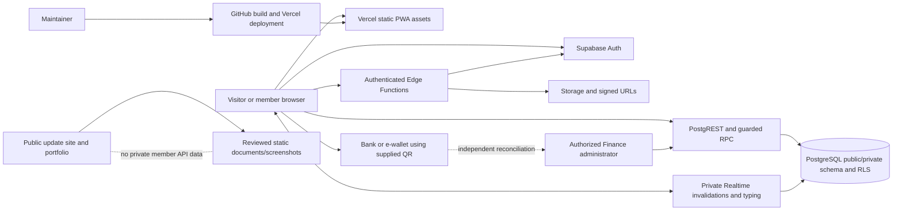

# 02 — Technical requirements

Prepared 31 October 2026 from the inspected PCEC source, reconstructed empty schema, existing tests and portfolio. Released baseline: 1.1.10. Items marked planned or awaiting acceptance are not shipped integrations. The QA report is the authority for completed test evidence.

## Stack assessment and constraints

| Layer | Verified technology / source | Decision |
| --- | --- | --- |
| Frontend | Plain TypeScript/native ES modules; HTML/CSS; no React runtime in the member app. | Keep routes/pages/services/components; do not transplant the React portfolio runtime. |
| Build/dependencies | TypeScript 7.0.2, esbuild 0.28.2, @supabase/realtime-js 2.117.3; Playwright 1.63.0 and Axe for tests. | Pinned app lockfile retained; no new dependency required for this update. |
| Backend | Managed Supabase Auth, PostgreSQL/PostgREST and private/public functions, Storage, Realtime, Deno Edge Functions. | Keep current permission boundaries and versioned migrations. |
| Session | Existing client-managed renewable bearer session and trusted server profile. | Do not describe the SPA as using HttpOnly server-session cookies; enforce CSP and server permissions. |
| Hosting | Vercel app at pcec-connect.vercel.app; separate update-pcec-app and tabuzoportfolio sites; optional Caddy deployment template. | Build/check/deploy each repository independently. |
| Payment | Static supplied Surgebox QR; manual report/review ledger. | No webhook or provider API adapter is claimed. |
| Portfolio | React 18/Vite, Lucide, native dialogs and self-hosted fonts. | Adapt interactions into existing PCEC native components, not a stack migration. |
| Monitoring | Minimal audit/outbox and local monitoring scripts with protected configuration. | Do not copy service keys or full payloads into public docs/screenshots. |

## Architecture

Frontend pages call typed services under src/lib/supabase. The router handles user-friendly destinations; authorization remains in trusted database/functions/Storage checks. Realtime broadcasts invalidate permitted state or convey ephemeral typing, rather than carrying private message bodies as a public feed. The service worker caches same-origin interface assets, not Supabase API responses. The reporting site contains reviewed static artifacts and never needs a member session or service key.

## Module technical specifications

| Module | Components/services | Processing, security and error contract |
| --- | --- | --- |
| Access/profile | auth pages; session/router; client/request-policy; profile-setup service | Consume callback safely, renew session, fetch trusted profile, enforce status/consent/setup, save setup atomically and preserve birthday lock. Distinct invalid/rate/network errors. |
| Home/news/events | home/news/events pages; content and registration/lifecycle services | Bounded lists and cursors; correct event dates/end/archive rules; approved-member reads; owner-bound registrations; safe text/links/images. |
| Community/people | community/friends/search pages; timeline, follow, relationship and action RPCs | Filter audiences/blocks before ranking/discovery; caller-bound writes; pagination/idempotency; safe reply parent relationship; failed-source reporting. |
| Chat | chat/groups pages; groups, controls, receipts and private channel services | Accepted membership on every history/live action; scoped managers; unique direct pair; quotas; ephemeral typing; optional receipt state; unsubscribe/abort on exit. |
| Giving | donate/activity pages; report/review/analytics RPCs; QR tools | Download original bounded image bytes; private receipt ownership; integer minor currency units; normalized references; atomic confirmation/ledger link; no fabricated provider status. |
| Prayer/media/directory | native forms/sheets, photo services, prayer RPCs, church reads | Allowed caller/target; safe file validation and signed access; owner/admin deletion; gallery event cleanup and playback stop; no new video uploader. |
| Administration | admin pages and typed admin services | Trusted admin role, bounded member projection/search, explicit confirmations, content and review transactions; no implied private-group or infrastructure access. |
| Documentation/portfolio | Static docs renderer/index and existing React project catalog | Trusted local source only; escaped rendering, valid links/downloads, captioned fixture images, no private source/log serving; no new member API. |

## API transport and authentication

The browser uses the configured Supabase origin with a publishable key and, for protected operations, the current bearer access token. Secret/service keys never belong in config.js or browser bundles. JSON/multipart requests use the existing bounded request policy. Query text and cursors are validated/escaped, and safe error messages are shown without raw provider secrets.

### Auth endpoints

| Method/path | Purpose / inputs | Success structure | Authentication / failures |
| --- | --- | --- | --- |
| POST /auth/v1/signup | Email/password plus allowed profile metadata and redirect. | Auth user plus nullable session. | Visitor request; duplicate/weak/invalid/rate errors; confirmation may be required. |
| POST /auth/v1/token?grant_type=password | Email/password. | Access/refresh session and user. | Credentials verified by managed Auth; invalid/unconfirmed/rate errors. |
| POST /auth/v1/token?grant_type=refresh_token | Refresh token from current client session. | Renewed session. | Valid refresh token; expiry/revocation requires sign-in. |
| GET /auth/v1/authorize?provider=google | OAuth provider and configured callback. | Redirect/callback flow. | Provider state and Auth verification; not an app-role grant. |
| GET /auth/v1/verify | Auth-managed email link parameters. | Verified callback/session or token error. | Valid email/recovery token; expired/invalid handled safely. |
| POST /auth/v1/recover; POST /auth/v1/resend | Email and permitted callback. | Managed request response. | Rate/delivery errors; UI must not claim inbox delivery without evidence. |
| GET /auth/v1/user; PUT /auth/v1/user | Read user or update permitted account credentials. | Managed Auth user. | Valid session/recovery; validate password rules. |
| POST /auth/v1/logout | Current session. | Logout response. | Clear local session and handle revoked/expired state. |

### Public-schema RPC inventory

Each row below is the actual reconstructed signature. Endpoint is POST /rest/v1/rpc/<name>; the JSON request uses its named arguments and defaults. Return types are PostgreSQL/JSON contracts and the typed frontend service supplies the feature-specific response shape. The PRD records related entities and business rules. Functions labelled internal are not member features and must retain their explicit execution grants and caller checks.

| RPC | JSON argument names/types/defaults | Response type | Required permission / related scope |
| --- | --- | --- | --- |
| ack_discord_audit_batch | event_ids bigint[] | void | Restricted service/internal quota/audit function; not a general member endpoint |
| chat_controls | p_action text, p_room uuid DEFAULT NULL::uuid, p_text text DEFAULT ''::text | jsonb | CHAT-007: A conversation member; CHAT-008: An approved member; CHAT-009: A member or authorized application admin; ADMIN-004: An authorized application admin |
| chat_groups | p_action text, p_room uuid DEFAULT NULL::uuid, p_target uuid DEFAULT NULL::uuid, p_text text DEFAULT ''::text | jsonb | CHAT-002: An approved member; CHAT-003: An approved member; CHAT-004: A group owner or authorized group admin; CHAT-008: An approved member; SEARCH-001: An approved member |
| chat_message_action | p_action text, p_id uuid, p_body text DEFAULT ''::text, p_expected_edit timestamp with time zone DEFAULT NULL::timestamp with time zone | jsonb | CHAT-005: A conversation member |
| chat_message_profiles | p_ids uuid[] | jsonb | Guarded support projection; inspect its grants and caller checks before use |
| chat_receipts | p_message_ids uuid[], p_read_ids uuid[] DEFAULT '{}'::uuid[] | jsonb | CHAT-007: A conversation member |
| community_actions | p_action text, p_post uuid DEFAULT NULL::uuid, p_ids uuid[] DEFAULT '{}'::uuid[] | jsonb | COM-005: An approved member |
| community_activity | No arguments | jsonb | NOTIF-001: An approved member |
| community_for_you | No arguments | SETOF community_posts | COM-002: An approved member |
| community_reactors | p_post_id uuid, p_after uuid DEFAULT NULL::uuid, p_limit integer DEFAULT 51 | TABLE(user_id uuid, kind text, display_name text, photo_url text) | COM-004: An approved member |
| community_reply | p_post uuid, p_parent uuid, p_body text | jsonb | COM-003: An approved member |
| community_timeline | p_before timestamp with time zone DEFAULT NULL::timestamp with time zone, p_author uuid DEFAULT NULL::uuid, p_limit integer DEFAULT 20, p_key text DEFAULT NULL::text | jsonb | HOME-001: An approved member; COM-002: An approved member |
| complete_profile_setup | p_name text, p_birthday date, p_phone text, p_phone_country text, p_dial text, p_country text, p_city text, p_church text, p_show_birthday boolean, p_show_location boolean | jsonb | PROF-001: A new or unfinished member |
| consume_request_limit | p_user uuid, p_action text | boolean | Restricted service/internal quota/audit function; not a general member endpoint |
| consume_upload_budget | p_user uuid, p_bytes bigint | boolean | Restricted service/internal quota/audit function; not a general member endpoint |
| donation_analytics | p_from date, p_through date, p_campaign text DEFAULT NULL::text | jsonb | DON-004: An authorized application admin |
| donation_report_page | p_admin boolean DEFAULT false, p_status text DEFAULT NULL::text, p_before_at timestamp with time zone DEFAULT NULL::timestamp with time zone, p_before_id uuid DEFAULT NULL::uuid | jsonb | DON-002: An approved donor; DON-003: An authorized application admin performing Finance duties |
| donation_transaction_page | p_from date, p_through date, p_campaign text DEFAULT NULL::text, p_status text DEFAULT NULL::text, p_before_at timestamp with time zone DEFAULT NULL::timestamp with time zone, p_before_id uuid DEFAULT NULL::uuid | jsonb | DON-004: An authorized application admin |
| event_lifecycle | p_action text, p_event uuid DEFAULT NULL::uuid, p_ends_at timestamp with time zone DEFAULT NULL::timestamp with time zone | jsonb | EVT-001: An approved member |
| get_cost_control_status | No arguments | jsonb | Restricted service/internal quota/audit function; not a general member endpoint |
| get_discord_audit_batch | No arguments | TABLE(id bigint, occurred_at timestamp with time zone, kind text, resource text, operation text) | Restricted service/internal quota/audit function; not a general member endpoint |
| member_directory | p_action text, p_target uuid DEFAULT NULL::uuid, p_query text DEFAULT ''::text, p_private boolean DEFAULT NULL::boolean | jsonb | PROF-003: An approved member; SOC-001: An approved member; SEARCH-001: An approved member |
| member_follows | p_action text, p_target uuid DEFAULT NULL::uuid, p_query text DEFAULT ''::text | jsonb | PROF-003: An approved member; SOC-001: An approved member; CHAT-002: An approved member; CHAT-003: An approved member |
| prayer_create | p_title text, p_body text DEFAULT ''::text, p_anonymous boolean DEFAULT false | uuid | PRAY-001: An approved member |
| prayer_delete | p_id uuid | void | PRAY-001: An approved member |
| prayer_hide | p_id uuid, p_hidden boolean | void | PRAY-001: An approved member |
| prayer_list | p_filter text DEFAULT 'active'::text, p_before timestamp with time zone DEFAULT NULL::timestamp with time zone, p_limit integer DEFAULT 30 | TABLE(id uuid, title text, body text, created_at timestamp with time zone, answered_at timestamp with time zone, answer_note text, is_anonymous boolean, author_id uuid, author_name text, author_photo text, is_mine boolean, prayed_count integer, i_prayed boolean, is_hidden boolean) | PRAY-001: An approved member |
| prayer_set_answered | p_id uuid, p_answered boolean, p_note text DEFAULT NULL::text | void | PRAY-001: An approved member |
| prayer_toggle | p_id uuid | TABLE(prayed boolean, prayed_count integer) | PRAY-001: An approved member |
| profile_details | p_target uuid | jsonb | PROF-003: An approved member |
| review_donation_report | p_id uuid, p_decision text, p_amount_minor bigint DEFAULT NULL::bigint, p_paid_at timestamp with time zone DEFAULT NULL::timestamp with time zone, p_reference text DEFAULT NULL::text, p_note text DEFAULT ''::text | uuid | DON-003: An authorized application admin performing Finance duties |
| social_members | p_action text, p_target uuid DEFAULT NULL::uuid, p_search text DEFAULT ''::text | jsonb | Guarded support projection; inspect its grants and caller checks before use |
| submit_donation_report | p_id uuid, p_method_id uuid, p_amount_minor bigint, p_payment_reference text, p_paid_at timestamp with time zone, p_receipt_path text DEFAULT NULL::text, p_note text DEFAULT ''::text | uuid | DON-002: An approved donor |

Requests can fail for invalid input, unavailable records, role/membership denial, rate limits, expired sessions or service failure. The client must distinguish these without inventing a universal status code: actual SQL/PostgREST errors vary by contract. Common HTTP 400/401/403/404/409/429/5xx categories are handled by the shared policy; never blindly retry an unsafe mutation. A successful network response is not proof that a third-party bank payment happened.

### Table REST and file endpoints

GET/POST/PATCH/DELETE /rest/v1/<table> are used only where the relevant role and RLS allow them; query fields, body and returned rows follow [the exact schema](05-Database-Schema-and-Implementation.md). Read projections such as member_list do not grant write access. Private-schema tables are not direct public REST resources. Each PRD feature names the actual related tables and allowed interaction.

POST /functions/v1/upload-file accepts the existing bucket/path/file multipart contract, checks token/status/origin, file signature, size, folder ownership and quotas, and returns the upload result consumed by the Storage wrapper. POST /functions/v1/delete-account authenticates the caller and performs its documented account/file cleanup. OPTIONS is CORS preflight, not proof of a successful upload/deletion. Private file viewers request short-lived signed Storage URLs; public avatar paths follow the designated avatar policy.

## Security requirements

- Trusted roles come from protected server data; user_metadata is user-editable and cannot authorize admin actions.
- RLS plus grants, owner predicates and guarded functions protect every exposed table/action. Private group acceptance, blocks and status are checked server-side. An admin label alone does not authorize unrelated private history.
- Security-definer helpers retain a fixed safe search path, narrow execute grants and explicit caller validation; do not remove a permission error by widening a helper's public access.
- Text enters the member DOM through the native text-node toolkit; untrusted HTML is not concatenated. Safe external links, strict CSP and private-path denials reduce XSS/source leakage.
- This bearer-token SPA does not depend on ambient application cookies for mutations. Validate OAuth callbacks and origins; preserve upload/function CORS checks. Any future cookie-based architecture needs a fresh CSRF assessment.
- Validate literal search/cursor input before forming PostgREST queries. Keep SQL parameterization and server constraints. Do not accept client author/donor/reviewer identities.
- Validate file bytes as well as MIME/extension; enforce user folder and bucket policy; never proxy unrestricted private files into a public portfolio gallery.
- Respect rate limits, Retry-After, request timeouts, concurrency and upload/cost budgets. Monitoring payloads stay minimal and omit content/credentials.
- Managed Auth handles password hashing. MFA enrollment/enforcement and restore acceptance are explicit FUT requirements, not completed by the login redesign.
- Log only necessary administrative events with approved retention; app data, prayer content and payment evidence require clear ownership/privacy policy.

## Performance and deployment acceptance

Targets: representative staging LCP ≤2.5s, interaction response ≤200ms and ordinary read API p95 ≤1s under a documented approved workload. These are targets, not production benchmark results. Preserve bounded list pages, keyset cursors, short-lived URL batching, image compression/lazy loading, bundled fonts and event cleanup. The baseline build has about 161 interface files/~2.02MB; that is build output, not a claim about every page's network cost.

Build with npm run typecheck and npm run build using the accepted HTTPS site origin. Verify release notes/package/worker/version alignment, headers, private-path denial and current client update behavior. Verify email/Google callback allowlists, function origins and install metadata on the final domain. Deploy the app, reporting site and portfolio independently. No schema migration is needed for the scoped gallery/docs/accessibility work; a future data change requires advisors, a reviewed versioned migration, backup and a rollback/forward-fix plan.
