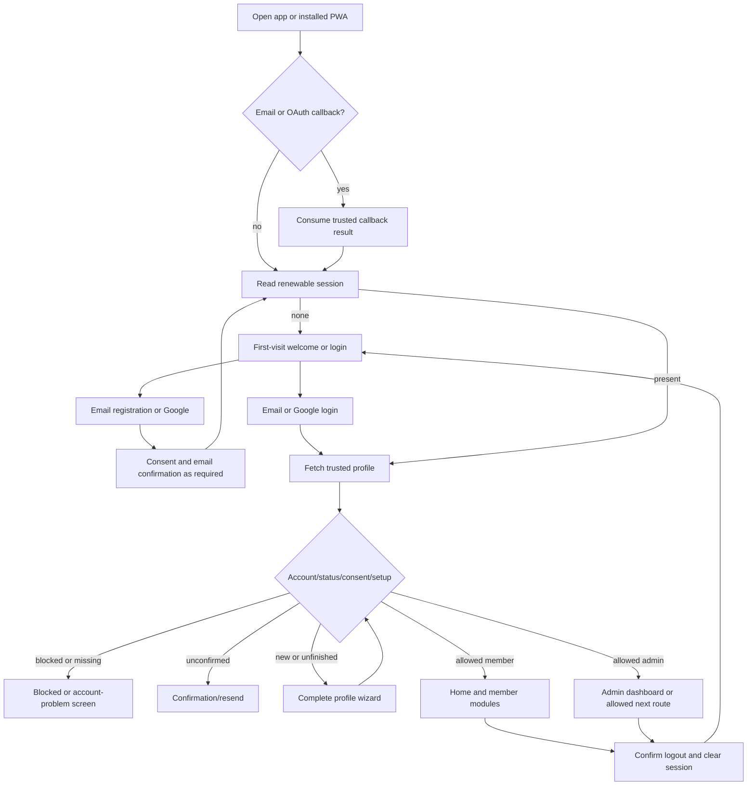
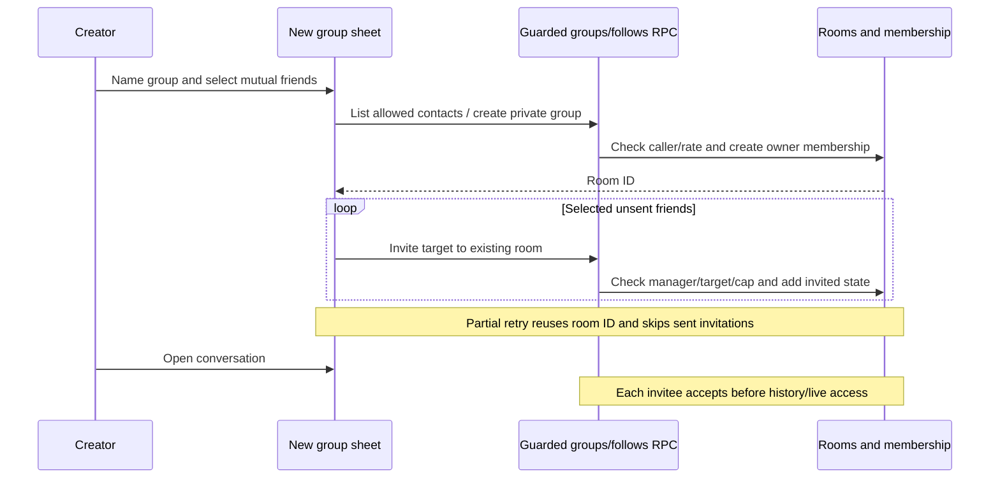
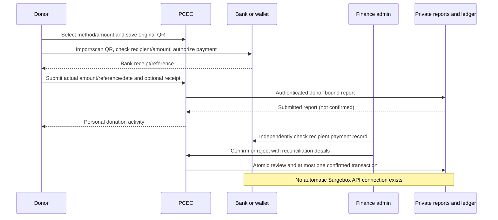

# 03 — Application flows and navigation

Prepared 31 October 2026 from the inspected PCEC source, reconstructed empty schema, existing tests and portfolio. Released baseline: 1.1.10. Items marked planned or awaiting acceptance are not shipped integrations. The QA report is the authority for completed test evidence.

## Opening the app through logout

The next destination must be a safe relative route and still passes guards. Completed/returning members opening /setup-profile return to Profile; ordinary edits do not rerun onboarding. A cached shell never changes a blocked account into an approved one.

## Role journeys

| Role | Primary journey | Write/exception behavior |
| --- | --- | --- |
| Visitor | Welcome → login/signup/Google, public guides/legal/install; recovery when needed. | No member writes; invalid input stays on the form with a useful message. |
| Unconfirmed | Register → check email → valid callback → trusted profile → setup/member route. | Resend observes rate limits; no administrator shortcut around email ownership. |
| Approved member | Home → Chat/Donate/About/Profile or Menu → chosen module → permitted action → server validation → refreshed state. | Own actions and permitted audiences only; expired sessions return to sign-in. |
| Group owner/admin | Chats → accepted group → settings → allowed privacy/member/role action → server membership update. | Owner transfer precedes leaving; removed/invited users cannot keep private history access. |
| Application admin | Login → Admin → member/content/report/inbox module → validate/confirm → protected write/review → refreshed list. | Admin access does not imply private-group membership or infrastructure access. |
| Finance/admin | Donation Reports → open report/private evidence → compare bank/provider record → confirm/reject → ledger/activity/analytics. | A report is not confirmed until verified; repeat confirmation does not duplicate a gift. |
| Maintainer | Review requirements/evidence → build/test → release/version check → deploy → read-only smoke checks → pilot acceptance. | No secret in client/report output; no destructive schema/production test by default. |

## Feature workflows

| Feature IDs | Normal workflow | Exception/return path |
| --- | --- | --- |
| AUTH-002…007 | Enter valid credentials/consent → managed Auth → callback/session → trusted profile → allowed route. | Invalid/unconfirmed/expired/suspended/missing-profile → specific explanation and safe recovery/logout. |
| PROF-001…003 | Newcomer wizard or Edit Profile → validate → guarded profile save → own profile/shared projection. | Birthday change denied; save failure retains the current flow; private fields omitted for unauthorized viewers. |
| NEWS-001 / EVT-001…002 | Home/list → selected article/event → current details → optional registration/cancel → own result. | No data/not found/ended event/duplicate registration → readable state without false success. |
| COM-001…006 | Open composer → audience/text/photo → optional crop → validate/upload → trusted post → feed → comments/reactions/save/share. | Cancel or upload/save failure does not publish; blocked/hidden/audience-denied content is not exposed. |
| SOC-001 | People/search/profile → follow/follow back → server relationship → mutual friend state and appropriate suggestions. | Private, blocked, self or unavailable target → no forbidden relationship/details. |
| CHAT-001…009 | Chats → shared/direct/accepted group → history → compose/send → private invalidation → refresh/receipt. | Pending invitation must be accepted; offline failure leaves current draft; preference/report actions are caller-scoped. |
| PRAY-001 | Prayer list → create/support → trusted request/support state → owner answered note when appropriate. | Unauthorized answer/delete denied; no-content/failure states remain clear. |
| MEDIA-001…002 | Media list → signed item → viewer → Previous/Next or arrows → caption/counter; upload photo → validated file and row. | Missing URL/one/empty item handled; cancel/close/route exit removes listeners and stops video; invalid upload rejected. |
| DON-001…004 | Choose method/amount → save supplied QR → bank/e-wallet verifies recipient and pays → return/report actual transfer → own activity → Finance reconciliation → confirmed totals. | Reference alone never auto-confirms; duplicates/mismatch/rejected review stay separate from confirmed amounts. |
| ADMIN-001…004 | Admin module → search/page/select → allowed form/action → confirmation when destructive → server authorization → updated target. | Role loss/stale item/validation/network failure leaves a clear failed state and retry path. |
| HELP-001 / DOC-001…002 | Contact form → server-bound inquiry; or open public guide/document → search/index/link/download. | No actual outbound email is implied by inquiry storage; public material contains no private member records. |
| SYS-001…004 | Theme/install/update/request events → supported local behavior → bounded service operation. | Offline/unsupported browser/failed metadata/rate limit → truthful fallback and controlled recovery. |

### Private group creation sequence

### Giving sequence

## Complete routed sitemap

Member mobile tabs are Home, Chat, Donate, About and Profile. Menu exposes the additional modules and App guides; desktop navigation exposes relevant extra links. Group settings uses /chats/:id while the conversation uses /chat/:id. The shared room is /chat. Public static guides at /guides/*.html sit outside this route table and do not load member data. The separate project-update site hosts the technical documentation pack.

| Path | Screen | Access |
| --- | --- | --- |
| /login | Log In | guest |
| /welcome | Welcome | guest |
| /install | Install the App | public |
| /signup | Sign Up | guest |
| /finish-signup | Finish sign-up | session |
| /setup-profile | Set up your profile | member |
| /check-email | Check your email | public |
| /forgot-password | Forgot password | public |
| /auth/callback | Signing in | public |
| /reset-password | New password | session |
| /pending | Confirm your email | session |
| /blocked | Account suspended | session |
| /account-problem | Profile missing | session |
| /terms | Terms of Service | public |
| /privacy | Privacy Notice | public |
| /delete-account | Delete your account | public |
| /account-deleted | Account deleted | public |
| / | PCEC Connect | member |
| /events | Events | member |
| /events/:id | Event | member |
| /about | About PCEC | member |
| /donate | Donate | member |
| /donate/activity | My donation activity | member |
| /profile | Profile | member |
| /chat | Chat | member |
| /chat/:id | Private chat | member |
| /saved | Saved posts | member |
| /search | Search | member |
| /chats | Chat | member |
| /friends | Friends | member |
| /chats/:id | Group settings | member |
| /community | Community Feed | member |
| /community/u/:id | Posts | member |
| /community/post/:id | Post | member |
| /notifications | Notifications | member |
| /menu | Menu | member |
| /news | Latest News | member |
| /news/:id | Announcement | member |
| /profile/edit | Edit Profile | member |
| /membership | Membership & NDC | member |
| /ndc | NDC | member |
| /media | Media | member |
| /contact | Contact Us | member |
| /settings | Settings | member |
| /prayer | Prayer Requests | member |
| /churches | Our Churches | member |
| /admin | Admin | admin |
| /admin/members | Members | admin |
| /admin/announcements | Announcements | admin |
| /admin/events | Events | admin |
| /admin/ndc | NDC Posts | admin |
| /admin/donations | Donation payment options | admin |
| /admin/donation-analytics | Donation analytics | admin |
| /admin/donation-reports | Donation reports | admin |
| /admin/inbox | Inbox | admin |
| /admin/community | Community | admin |
| /admin/chat-reports | Chat reports | admin |
| /admin/about | About & Office Info | admin |
| /admin/churches | Churches | admin |

## Error and exceptional flows

| Condition | Required behavior | Recovery |
| --- | --- | --- |
| Invalid credentials/input | Keep the form, label the relevant field and display sanitized guidance. | Correct input or choose recovery; never show false success. |
| Unauthorized role/room/record | Server denies; router offers the permitted destination. | Return to Home/login/request acceptance as appropriate. |
| Session expiry or suspension | Stop treating the prior UI state as authority; protected requests fail. | Renew a valid session or sign in/contact support; no silent permission expansion. |
| Offline/network failure | Retain the current supported draft; show a bounded retry/offline state. | Reconnect and revalidate; no claim of a general durable submission queue. |
| Database/save/upload failure | Do not confirm a successful action; clean an orphan upload where supported. | Retry safely with existing mutation identity or return without changing previous content. |
| Partial group invitations | Show that the group already exists and how many invitations succeeded. | Retry remaining targets or open that group; never create another room automatically. |
| Missing/deleted/empty data | Readable not-found/no-items/unavailable image state. | Back, refresh, search or create an authorized item. |
| Payment mismatch/duplicate/unverified TN | Keep report separate from confirmed giving and show review status. | Finance checks real records; do not infer confirmation from a scan. |
| Update/crop/gallery cancellation | Abort callbacks/listeners and leave the previous draft/tab intact. | Reopen safely; no draw on a closed bitmap or stale keyboard handler. |
