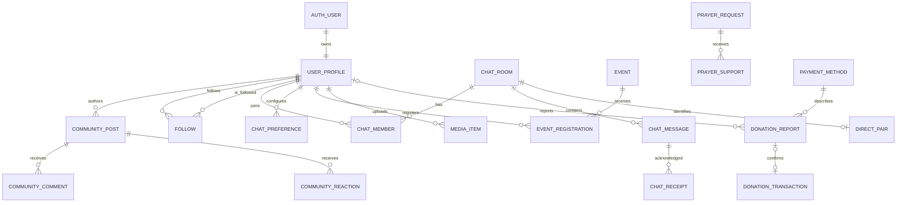

# 05 — Database schema and implementation

Prepared 31 October 2026 from the inspected PCEC source, reconstructed empty schema, existing tests and portfolio. Released baseline: 1.1.10. Items marked planned or awaiting acceptance are not shipped integrations. The QA report is the authority for completed test evidence.

## Assessment and provenance

The catalog below is reconstructed from the actual checked-in schema and 29 migration files in an empty isolated PGlite/PostgreSQL-compatible test database. It documents 38 application tables, one view, 287 columns and 90 application functions across public/private. Managed Auth/Storage/Realtime internals are service-owned and not reproduced as if they were application tables. Limited live REST checks confirmed core RPC availability and selected anonymous boundaries; full live PostgreSQL catalog/advisor access was not available through the connected project tool. Do not call this a complete live schema or security audit.

## Data model decisions

Keep existing normalized relationship/junction records, private donor/receipt/preferences/follow data, server-bound author identities, minor-unit monetary values, timestamps and uniqueness constraints. The member_list view is a scoped administrative projection, not another profile write table. Name snapshots in content/donations support historical/audit display and are not arbitrary duplicate user records. Retained resources/attendance and legacy friendship compatibility require an inventory/retention decision before removal. No table is dropped or production record overwritten in this work.

The scoped gallery, documentation and accessibility changes need no new database table or migration. This document's proposed state is the existing schema plus preserved permissions. Future MFA, backup operations, provider events, push subscriptions, offline queues, AI or dual Finance approval need an individually reviewed contract/migration; no placeholder table is presented as deployed.

## Conceptual ERD



The ERD abbreviates domain names for readability. The exact names, key columns, nullable relationships and delete behavior are in each object's constraint table below. Optional account links on retained financial records are distinct from mandatory conversation/post ownership. Many-to-many relations include follows, group membership, reactions, supports, registrations and saved posts.

## Storage and managed-service boundaries

| Bucket | Public | Size limit (bytes) | Allowed MIME types |
| --- | --- | --- | --- |
| announcement-images | No | 5242880 | image/png, image/jpeg, image/jpg, image/webp |
| community-photos | No | 5242880 | image/png, image/jpeg, image/jpg, image/webp |
| donation-receipts | No | 5242880 | image/png, image/jpeg, image/jpg, image/webp |
| media | No | 5242880 | image/png, image/jpeg, image/jpg, image/webp |
| profile-photos | Yes | 5242880 | image/png, image/jpeg, image/jpg, image/webp |


Profile photos follow the designated public-avatar policy. Other listed buckets are private; use caller permissions and short-lived signed URLs. A database backup does not by itself restore the file objects. Edge upload validation, folder ownership and budgets supplement bucket policy. The schema metadata above is source-derived, and actual deployment/bucket limits must be checked before a production change.

## Complete application object catalog

## private.chat_message_receipts

Kind: table. RLS flag in reconstructed catalog: enabled.

| Column | Data type | Nullable | Default |
| --- | --- | --- | --- |
| message_id | uuid | No | No explicit default |
| user_id | uuid | No | No explicit default |
| delivered_at | timestamp with time zone | No | clock_timestamp() |
| read_at | timestamp with time zone | Yes | No explicit default |


### Keys, relationships and constraints

| Constraint | Kind | Definition |
| --- | --- | --- |
| chat_message_receipts_delivered_at_not_null | n | NOT NULL delivered_at |
| chat_message_receipts_message_id_fkey | foreign key | FOREIGN KEY (message_id) REFERENCES chat_messages(id) ON DELETE CASCADE |
| chat_message_receipts_message_id_not_null | n | NOT NULL message_id |
| chat_message_receipts_pkey | primary key | PRIMARY KEY (message_id, user_id) |
| chat_message_receipts_user_id_fkey | foreign key | FOREIGN KEY (user_id) REFERENCES user_profile(id) ON DELETE CASCADE |
| chat_message_receipts_user_id_not_null | n | NOT NULL user_id |


### Indexes

| Index | Definition |
| --- | --- |
| chat_message_receipts_pkey | CREATE UNIQUE INDEX chat_message_receipts_pkey ON private.chat_message_receipts USING btree (message_id, user_id) |


## private.chat_preferences

Kind: table. RLS flag in reconstructed catalog: enabled.

| Column | Data type | Nullable | Default |
| --- | --- | --- | --- |
| user_id | uuid | No | No explicit default |
| room_key | text | No | No explicit default |
| room_id | uuid | Yes | No explicit default |
| archived | boolean | No | false |
| muted | boolean | No | false |
| restricted | boolean | No | false |
| read_receipts | boolean | No | true |
| deleted_before | timestamp with time zone | Yes | No explicit default |
| updated_at | timestamp with time zone | No | clock_timestamp() |


### Keys, relationships and constraints

| Constraint | Kind | Definition |
| --- | --- | --- |
| chat_preferences_archived_not_null | n | NOT NULL archived |
| chat_preferences_check | check | CHECK ((room_key = COALESCE((room_id)::text, 'community'::text))) |
| chat_preferences_muted_not_null | n | NOT NULL muted |
| chat_preferences_pkey | primary key | PRIMARY KEY (user_id, room_key) |
| chat_preferences_read_receipts_not_null | n | NOT NULL read_receipts |
| chat_preferences_restricted_not_null | n | NOT NULL restricted |
| chat_preferences_room_id_fkey | foreign key | FOREIGN KEY (room_id) REFERENCES chat_rooms(id) ON DELETE CASCADE |
| chat_preferences_room_key_not_null | n | NOT NULL room_key |
| chat_preferences_updated_at_not_null | n | NOT NULL updated_at |
| chat_preferences_user_id_fkey | foreign key | FOREIGN KEY (user_id) REFERENCES user_profile(id) ON DELETE CASCADE |
| chat_preferences_user_id_not_null | n | NOT NULL user_id |


### Indexes

| Index | Definition |
| --- | --- |
| chat_preferences_pkey | CREATE UNIQUE INDEX chat_preferences_pkey ON private.chat_preferences USING btree (user_id, room_key) |
| chat_preferences_room | CREATE INDEX chat_preferences_room ON private.chat_preferences USING btree (room_id) WHERE restricted |


## private.chat_spam_reports

Kind: table. RLS flag in reconstructed catalog: enabled.

| Column | Data type | Nullable | Default |
| --- | --- | --- | --- |
| id | uuid | No | gen_random_uuid() |
| reporter_id | uuid | Yes | No explicit default |
| room_key | text | No | No explicit default |
| room_title | text | No | No explicit default |
| room_id | uuid | Yes | No explicit default |
| message_id | uuid | Yes | No explicit default |
| author_id | uuid | Yes | No explicit default |
| reason | text | No | No explicit default |
| report_type | text | No | 'message'::text |
| created_at | timestamp with time zone | No | clock_timestamp() |
| resolved_at | timestamp with time zone | Yes | No explicit default |


### Keys, relationships and constraints

| Constraint | Kind | Definition |
| --- | --- | --- |
| chat_spam_reports_author_id_fkey | foreign key | FOREIGN KEY (author_id) REFERENCES user_profile(id) ON DELETE SET NULL |
| chat_spam_reports_created_at_not_null | n | NOT NULL created_at |
| chat_spam_reports_id_not_null | n | NOT NULL id |
| chat_spam_reports_message_id_fkey | foreign key | FOREIGN KEY (message_id) REFERENCES chat_messages(id) ON DELETE SET NULL |
| chat_spam_reports_pkey | primary key | PRIMARY KEY (id) |
| chat_spam_reports_reason_check | check | CHECK (((length(reason) >= 1) AND (length(reason) <= 500))) |
| chat_spam_reports_reason_not_null | n | NOT NULL reason |
| chat_spam_reports_report_type_check | check | CHECK ((report_type = ANY (ARRAY['message'::text, 'request'::text]))) |
| chat_spam_reports_report_type_not_null | n | NOT NULL report_type |
| chat_spam_reports_reporter_id_fkey | foreign key | FOREIGN KEY (reporter_id) REFERENCES user_profile(id) ON DELETE SET NULL |
| chat_spam_reports_room_id_fkey | foreign key | FOREIGN KEY (room_id) REFERENCES chat_rooms(id) ON DELETE SET NULL |
| chat_spam_reports_room_key_not_null | n | NOT NULL room_key |
| chat_spam_reports_room_title_not_null | n | NOT NULL room_title |


### Indexes

| Index | Definition |
| --- | --- |
| chat_report_open | CREATE UNIQUE INDEX chat_report_open ON private.chat_spam_reports USING btree (reporter_id, room_key) WHERE (resolved_at IS NULL) |
| chat_reports_recent | CREATE INDEX chat_reports_recent ON private.chat_spam_reports USING btree (created_at DESC) |
| chat_spam_reports_pkey | CREATE UNIQUE INDEX chat_spam_reports_pkey ON private.chat_spam_reports USING btree (id) |


## private.community_saves

Kind: table. RLS flag in reconstructed catalog: enabled.

| Column | Data type | Nullable | Default |
| --- | --- | --- | --- |
| user_id | uuid | No | No explicit default |
| post_id | uuid | No | No explicit default |
| created_at | timestamp with time zone | No | clock_timestamp() |


### Keys, relationships and constraints

| Constraint | Kind | Definition |
| --- | --- | --- |
| community_saves_created_at_not_null | n | NOT NULL created_at |
| community_saves_pkey | primary key | PRIMARY KEY (user_id, post_id) |
| community_saves_post_id_fkey | foreign key | FOREIGN KEY (post_id) REFERENCES community_posts(id) ON DELETE CASCADE |
| community_saves_post_id_not_null | n | NOT NULL post_id |
| community_saves_user_id_fkey | foreign key | FOREIGN KEY (user_id) REFERENCES user_profile(id) ON DELETE CASCADE |
| community_saves_user_id_not_null | n | NOT NULL user_id |


### Indexes

| Index | Definition |
| --- | --- |
| community_saves_pkey | CREATE UNIQUE INDEX community_saves_pkey ON private.community_saves USING btree (user_id, post_id) |


## private.cost_alerts

Kind: table. RLS flag in reconstructed catalog: enabled.

| Column | Data type | Nullable | Default |
| --- | --- | --- | --- |
| dedupe_key | text | No | No explicit default |
| severity | text | No | No explicit default |
| message | text | No | No explicit default |
| first_seen | timestamp with time zone | No | now() |
| last_seen | timestamp with time zone | No | now() |


### Keys, relationships and constraints

| Constraint | Kind | Definition |
| --- | --- | --- |
| cost_alerts_dedupe_key_not_null | n | NOT NULL dedupe_key |
| cost_alerts_first_seen_not_null | n | NOT NULL first_seen |
| cost_alerts_last_seen_not_null | n | NOT NULL last_seen |
| cost_alerts_message_not_null | n | NOT NULL message |
| cost_alerts_pkey | primary key | PRIMARY KEY (dedupe_key) |
| cost_alerts_severity_check | check | CHECK ((severity = ANY (ARRAY['warning'::text, 'critical'::text]))) |
| cost_alerts_severity_not_null | n | NOT NULL severity |


### Indexes

| Index | Definition |
| --- | --- |
| cost_alerts_pkey | CREATE UNIQUE INDEX cost_alerts_pkey ON private.cost_alerts USING btree (dedupe_key) |


## private.cost_usage

Kind: table. RLS flag in reconstructed catalog: enabled.

| Column | Data type | Nullable | Default |
| --- | --- | --- | --- |
| scope | text | No | No explicit default |
| metric | text | No | No explicit default |
| window_start | date | No | No explicit default |
| amount | bigint | No | No explicit default |


### Keys, relationships and constraints

| Constraint | Kind | Definition |
| --- | --- | --- |
| cost_usage_amount_check | check | CHECK ((amount >= 0)) |
| cost_usage_amount_not_null | n | NOT NULL amount |
| cost_usage_metric_not_null | n | NOT NULL metric |
| cost_usage_pkey | primary key | PRIMARY KEY (scope, metric, window_start) |
| cost_usage_scope_not_null | n | NOT NULL scope |
| cost_usage_window_start_not_null | n | NOT NULL window_start |


### Indexes

| Index | Definition |
| --- | --- |
| cost_usage_pkey | CREATE UNIQUE INDEX cost_usage_pkey ON private.cost_usage USING btree (scope, metric, window_start) |


## private.direct_conversations

Kind: table. RLS flag in reconstructed catalog: enabled.

| Column | Data type | Nullable | Default |
| --- | --- | --- | --- |
| room_id | uuid | No | No explicit default |
| first_id | uuid | No | No explicit default |
| second_id | uuid | No | No explicit default |


### Keys, relationships and constraints

| Constraint | Kind | Definition |
| --- | --- | --- |
| direct_conversations_check | check | CHECK ((first_id < second_id)) |
| direct_conversations_first_id_fkey | foreign key | FOREIGN KEY (first_id) REFERENCES user_profile(id) ON DELETE CASCADE |
| direct_conversations_first_id_not_null | n | NOT NULL first_id |
| direct_conversations_first_id_second_id_key | unique | UNIQUE (first_id, second_id) |
| direct_conversations_pkey | primary key | PRIMARY KEY (room_id) |
| direct_conversations_room_id_fkey | foreign key | FOREIGN KEY (room_id) REFERENCES chat_rooms(id) ON DELETE CASCADE |
| direct_conversations_room_id_not_null | n | NOT NULL room_id |
| direct_conversations_second_id_fkey | foreign key | FOREIGN KEY (second_id) REFERENCES user_profile(id) ON DELETE CASCADE |
| direct_conversations_second_id_not_null | n | NOT NULL second_id |


### Indexes

| Index | Definition |
| --- | --- |
| direct_conversations_first_id_second_id_key | CREATE UNIQUE INDEX direct_conversations_first_id_second_id_key ON private.direct_conversations USING btree (first_id, second_id) |
| direct_conversations_pkey | CREATE UNIQUE INDEX direct_conversations_pkey ON private.direct_conversations USING btree (room_id) |


## private.discord_audit_outbox

Kind: table. RLS flag in reconstructed catalog: enabled.

| Column | Data type | Nullable | Default |
| --- | --- | --- | --- |
| id | bigint | No | No explicit default |
| occurred_at | timestamp with time zone | No | clock_timestamp() |
| kind | text | No | No explicit default |
| resource | text | No | No explicit default |
| operation | text | No | No explicit default |
| delivered_at | timestamp with time zone | Yes | No explicit default |


### Keys, relationships and constraints

| Constraint | Kind | Definition |
| --- | --- | --- |
| discord_audit_outbox_id_not_null | n | NOT NULL id |
| discord_audit_outbox_kind_check | check | CHECK ((kind = ANY (ARRAY['permission_change'::text, 'admin_action'::text]))) |
| discord_audit_outbox_kind_not_null | n | NOT NULL kind |
| discord_audit_outbox_occurred_at_not_null | n | NOT NULL occurred_at |
| discord_audit_outbox_operation_check | check | CHECK ((operation = ANY (ARRAY['INSERT'::text, 'UPDATE'::text, 'DELETE'::text]))) |
| discord_audit_outbox_operation_not_null | n | NOT NULL operation |
| discord_audit_outbox_pkey | primary key | PRIMARY KEY (id) |
| discord_audit_outbox_resource_not_null | n | NOT NULL resource |


### Indexes

| Index | Definition |
| --- | --- |
| discord_audit_outbox_pkey | CREATE UNIQUE INDEX discord_audit_outbox_pkey ON private.discord_audit_outbox USING btree (id) |
| discord_audit_pending | CREATE INDEX discord_audit_pending ON private.discord_audit_outbox USING btree (id) WHERE (delivered_at IS NULL) |


## private.donation_reports

Kind: table. RLS flag in reconstructed catalog: enabled.

| Column | Data type | Nullable | Default |
| --- | --- | --- | --- |
| id | uuid | No | No explicit default |
| donor_id | uuid | Yes | No explicit default |
| donor_name | text | No | No explicit default |
| method_id | uuid | Yes | No explicit default |
| method_name | text | No | No explicit default |
| amount_minor | bigint | No | No explicit default |
| payment_reference | text | No | No explicit default |
| reported_paid_at | timestamp with time zone | No | No explicit default |
| receipt_path | text | Yes | No explicit default |
| donor_note | text | No | ''::text |
| status | text | No | 'pending'::text |
| created_at | timestamp with time zone | No | now() |
| reviewed_at | timestamp with time zone | Yes | No explicit default |
| reviewed_by | uuid | Yes | No explicit default |
| review_note | text | No | ''::text |
| confirmed_amount_minor | bigint | Yes | No explicit default |
| transaction_id | uuid | Yes | No explicit default |


### Keys, relationships and constraints

| Constraint | Kind | Definition |
| --- | --- | --- |
| donation_reports_amount_minor_check | check | CHECK (((amount_minor >= 1) AND (amount_minor <= '100000000000'::bigint))) |
| donation_reports_amount_minor_not_null | n | NOT NULL amount_minor |
| donation_reports_check | check | CHECK ((((status = 'pending'::text) AND (reviewed_at IS NULL) AND (transaction_id IS NULL)) OR ((status = 'rejected'::text) AND (reviewed_at IS NOT NULL) AND (transaction_id IS NULL)) OR ((status = 'confirmed'::text) AND (reviewed_at IS NOT NULL) AND (transaction_id IS NOT NULL) AND (confirmed_amount_minor IS NOT NULL)))) |
| donation_reports_confirmed_amount_minor_check | check | CHECK (((confirmed_amount_minor >= 1) AND (confirmed_amount_minor <= '100000000000'::bigint))) |
| donation_reports_created_at_not_null | n | NOT NULL created_at |
| donation_reports_donor_id_fkey | foreign key | FOREIGN KEY (donor_id) REFERENCES auth.users(id) ON DELETE SET NULL |
| donation_reports_donor_name_not_null | n | NOT NULL donor_name |
| donation_reports_donor_note_check | check | CHECK ((length(donor_note) <= 1000)) |
| donation_reports_donor_note_not_null | n | NOT NULL donor_note |
| donation_reports_id_not_null | n | NOT NULL id |
| donation_reports_method_id_fkey | foreign key | FOREIGN KEY (method_id) REFERENCES donation_center(id) ON DELETE SET NULL |
| donation_reports_method_name_not_null | n | NOT NULL method_name |
| donation_reports_payment_reference_check | check | CHECK (((length(payment_reference) >= 3) AND (length(payment_reference) <= 200))) |
| donation_reports_payment_reference_not_null | n | NOT NULL payment_reference |
| donation_reports_pkey | primary key | PRIMARY KEY (id) |
| donation_reports_reported_paid_at_not_null | n | NOT NULL reported_paid_at |
| donation_reports_review_note_check | check | CHECK ((length(review_note) <= 1000)) |
| donation_reports_review_note_not_null | n | NOT NULL review_note |
| donation_reports_reviewed_by_fkey | foreign key | FOREIGN KEY (reviewed_by) REFERENCES auth.users(id) ON DELETE SET NULL |
| donation_reports_status_check | check | CHECK ((status = ANY (ARRAY['pending'::text, 'confirmed'::text, 'rejected'::text]))) |
| donation_reports_status_not_null | n | NOT NULL status |
| donation_reports_transaction_id_fkey | foreign key | FOREIGN KEY (transaction_id) REFERENCES private.donation_transactions(id) |
| donation_reports_transaction_id_key | unique | UNIQUE (transaction_id) |


### Indexes

| Index | Definition |
| --- | --- |
| donation_report_reference_idx | CREATE UNIQUE INDEX donation_report_reference_idx ON private.donation_reports USING btree (method_id, lower(payment_reference)) WHERE (status = ANY (ARRAY['pending'::text, 'confirmed'::text])) |
| donation_reports_donor_idx | CREATE INDEX donation_reports_donor_idx ON private.donation_reports USING btree (donor_id, created_at DESC, id DESC) |
| donation_reports_method_idx | CREATE INDEX donation_reports_method_idx ON private.donation_reports USING btree (method_id) |
| donation_reports_pkey | CREATE UNIQUE INDEX donation_reports_pkey ON private.donation_reports USING btree (id) |
| donation_reports_reviewer_idx | CREATE INDEX donation_reports_reviewer_idx ON private.donation_reports USING btree (reviewed_by) |
| donation_reports_status_idx | CREATE INDEX donation_reports_status_idx ON private.donation_reports USING btree (status, created_at DESC, id DESC) |
| donation_reports_transaction_id_key | CREATE UNIQUE INDEX donation_reports_transaction_id_key ON private.donation_reports USING btree (transaction_id) |


## private.donation_sources

Kind: table. RLS flag in reconstructed catalog: enabled.

| Column | Data type | Nullable | Default |
| --- | --- | --- | --- |
| provider | text | No | No explicit default |
| display_name | text | No | No explicit default |
| is_connected | boolean | No | false |
| last_synced_at | timestamp with time zone | Yes | No explicit default |


### Keys, relationships and constraints

| Constraint | Kind | Definition |
| --- | --- | --- |
| donation_sources_display_name_check | check | CHECK (((length(display_name) >= 1) AND (length(display_name) <= 160))) |
| donation_sources_display_name_not_null | n | NOT NULL display_name |
| donation_sources_is_connected_not_null | n | NOT NULL is_connected |
| donation_sources_pkey | primary key | PRIMARY KEY (provider) |
| donation_sources_provider_check | check | CHECK (((length(provider) >= 1) AND (length(provider) <= 100))) |
| donation_sources_provider_not_null | n | NOT NULL provider |


### Indexes

| Index | Definition |
| --- | --- |
| donation_sources_pkey | CREATE UNIQUE INDEX donation_sources_pkey ON private.donation_sources USING btree (provider) |


## private.donation_transactions

Kind: table. RLS flag in reconstructed catalog: enabled.

| Column | Data type | Nullable | Default |
| --- | --- | --- | --- |
| id | uuid | No | gen_random_uuid() |
| provider | text | No | No explicit default |
| provider_transaction_id | text | No | No explicit default |
| reference | text | Yes | No explicit default |
| campaign_key | text | No | 'general'::text |
| campaign_name | text | No | 'General Fund'::text |
| donor_id | uuid | Yes | No explicit default |
| donor_key | text | Yes | No explicit default |
| donor_name | text | Yes | No explicit default |
| anonymous | boolean | No | false |
| currency | text | No | 'PHP'::text |
| amount_minor | bigint | No | No explicit default |
| refunded_minor | bigint | No | 0 |
| fee_minor | bigint | Yes | No explicit default |
| status | text | No | No explicit default |
| created_at | timestamp with time zone | No | now() |
| paid_at | timestamp with time zone | Yes | No explicit default |
| updated_at | timestamp with time zone | No | now() |
| activity_at | timestamp with time zone | Yes | COALESCE(paid_at, created_at) |


### Keys, relationships and constraints

| Constraint | Kind | Definition |
| --- | --- | --- |
| donation_transactions_amount_minor_check | check | CHECK (((amount_minor > 0) AND (amount_minor <= '100000000000'::bigint))) |
| donation_transactions_amount_minor_not_null | n | NOT NULL amount_minor |
| donation_transactions_anonymous_not_null | n | NOT NULL anonymous |
| donation_transactions_campaign_key_check | check | CHECK (((length(campaign_key) >= 1) AND (length(campaign_key) <= 200))) |
| donation_transactions_campaign_key_not_null | n | NOT NULL campaign_key |
| donation_transactions_campaign_name_check | check | CHECK (((length(campaign_name) >= 1) AND (length(campaign_name) <= 200))) |
| donation_transactions_campaign_name_not_null | n | NOT NULL campaign_name |
| donation_transactions_check | check | CHECK (((refunded_minor >= 0) AND (refunded_minor <= amount_minor))) |
| donation_transactions_check1 | check | CHECK (((fee_minor >= 0) AND (fee_minor <= amount_minor))) |
| donation_transactions_check2 | check | CHECK (((status <> ALL (ARRAY['paid'::text, 'refunded'::text])) OR (paid_at IS NOT NULL))) |
| donation_transactions_check3 | check | CHECK (((refunded_minor = 0) OR (status = ANY (ARRAY['paid'::text, 'refunded'::text])))) |
| donation_transactions_check4 | check | CHECK (((status <> 'refunded'::text) OR (refunded_minor = amount_minor))) |
| donation_transactions_created_at_not_null | n | NOT NULL created_at |
| donation_transactions_currency_check | check | CHECK ((currency = 'PHP'::text)) |
| donation_transactions_currency_not_null | n | NOT NULL currency |
| donation_transactions_donor_id_fkey | foreign key | FOREIGN KEY (donor_id) REFERENCES auth.users(id) ON DELETE SET NULL |
| donation_transactions_donor_key_check | check | CHECK ((length(donor_key) <= 200)) |
| donation_transactions_donor_name_check | check | CHECK ((length(donor_name) <= 200)) |
| donation_transactions_id_not_null | n | NOT NULL id |
| donation_transactions_pkey | primary key | PRIMARY KEY (id) |
| donation_transactions_provider_fkey | foreign key | FOREIGN KEY (provider) REFERENCES private.donation_sources(provider) |
| donation_transactions_provider_not_null | n | NOT NULL provider |
| donation_transactions_provider_provider_transaction_id_key | unique | UNIQUE (provider, provider_transaction_id) |
| donation_transactions_provider_transaction_id_check | check | CHECK (((length(provider_transaction_id) >= 1) AND (length(provider_transaction_id) <= 200))) |
| donation_transactions_provider_transaction_id_not_null | n | NOT NULL provider_transaction_id |
| donation_transactions_reference_check | check | CHECK ((length(reference) <= 240)) |
| donation_transactions_refunded_minor_not_null | n | NOT NULL refunded_minor |
| donation_transactions_status_check | check | CHECK ((status = ANY (ARRAY['pending'::text, 'paid'::text, 'failed'::text, 'expired'::text, 'refunded'::text]))) |
| donation_transactions_status_not_null | n | NOT NULL status |
| donation_transactions_updated_at_not_null | n | NOT NULL updated_at |


### Indexes

| Index | Definition |
| --- | --- |
| donation_activity_idx | CREATE INDEX donation_activity_idx ON private.donation_transactions USING btree (activity_at DESC, id DESC) |
| donation_campaign_activity_idx | CREATE INDEX donation_campaign_activity_idx ON private.donation_transactions USING btree (campaign_key, activity_at DESC, id DESC) |
| donation_donor_idx | CREATE INDEX donation_donor_idx ON private.donation_transactions USING btree (donor_id) WHERE (donor_id IS NOT NULL) |
| donation_transactions_pkey | CREATE UNIQUE INDEX donation_transactions_pkey ON private.donation_transactions USING btree (id) |
| donation_transactions_provider_provider_transaction_id_key | CREATE UNIQUE INDEX donation_transactions_provider_provider_transaction_id_key ON private.donation_transactions USING btree (provider, provider_transaction_id) |


## private.member_follows

Kind: table. RLS flag in reconstructed catalog: enabled.

| Column | Data type | Nullable | Default |
| --- | --- | --- | --- |
| follower_id | uuid | No | No explicit default |
| followed_id | uuid | No | No explicit default |
| created_at | timestamp with time zone | No | now() |


### Keys, relationships and constraints

| Constraint | Kind | Definition |
| --- | --- | --- |
| member_follows_check | check | CHECK ((follower_id <> followed_id)) |
| member_follows_created_at_not_null | n | NOT NULL created_at |
| member_follows_followed_id_fkey | foreign key | FOREIGN KEY (followed_id) REFERENCES user_profile(id) ON DELETE CASCADE |
| member_follows_followed_id_not_null | n | NOT NULL followed_id |
| member_follows_follower_id_fkey | foreign key | FOREIGN KEY (follower_id) REFERENCES user_profile(id) ON DELETE CASCADE |
| member_follows_follower_id_not_null | n | NOT NULL follower_id |
| member_follows_pkey | primary key | PRIMARY KEY (follower_id, followed_id) |


### Indexes

| Index | Definition |
| --- | --- |
| member_follows_incoming | CREATE INDEX member_follows_incoming ON private.member_follows USING btree (followed_id, created_at DESC) |
| member_follows_pkey | CREATE UNIQUE INDEX member_follows_pkey ON private.member_follows USING btree (follower_id, followed_id) |


## private.member_privacy

Kind: table. RLS flag in reconstructed catalog: enabled.

| Column | Data type | Nullable | Default |
| --- | --- | --- | --- |
| user_id | uuid | No | No explicit default |
| is_private | boolean | No | false |


### Keys, relationships and constraints

| Constraint | Kind | Definition |
| --- | --- | --- |
| member_privacy_is_private_not_null | n | NOT NULL is_private |
| member_privacy_pkey | primary key | PRIMARY KEY (user_id) |
| member_privacy_user_id_fkey | foreign key | FOREIGN KEY (user_id) REFERENCES user_profile(id) ON DELETE CASCADE |
| member_privacy_user_id_not_null | n | NOT NULL user_id |


### Indexes

| Index | Definition |
| --- | --- |
| member_privacy_pkey | CREATE UNIQUE INDEX member_privacy_pkey ON private.member_privacy USING btree (user_id) |


## private.request_limits

Kind: table. RLS flag in reconstructed catalog: enabled.

| Column | Data type | Nullable | Default |
| --- | --- | --- | --- |
| user_id | uuid | No | No explicit default |
| action | text | No | No explicit default |
| window_start | timestamp with time zone | No | No explicit default |
| hits | integer | No | No explicit default |


### Keys, relationships and constraints

| Constraint | Kind | Definition |
| --- | --- | --- |
| request_limits_action_not_null | n | NOT NULL action |
| request_limits_hits_check | check | CHECK ((hits > 0)) |
| request_limits_hits_not_null | n | NOT NULL hits |
| request_limits_pkey | primary key | PRIMARY KEY (user_id, action, window_start) |
| request_limits_user_id_fkey | foreign key | FOREIGN KEY (user_id) REFERENCES auth.users(id) ON DELETE CASCADE |
| request_limits_user_id_not_null | n | NOT NULL user_id |
| request_limits_window_start_not_null | n | NOT NULL window_start |


### Indexes

| Index | Definition |
| --- | --- |
| request_limits_pkey | CREATE UNIQUE INDEX request_limits_pkey ON private.request_limits USING btree (user_id, action, window_start) |


## public.about_pcec

Kind: table. RLS flag in reconstructed catalog: enabled.

| Column | Data type | Nullable | Default |
| --- | --- | --- | --- |
| id | integer | No | 1 |
| org_name | text | Yes | 'PCEC'::text |
| about_text | text | Yes | ''::text |
| office_contact_number | text | Yes | ''::text |
| office_email | text | Yes | ''::text |
| office_location | text | Yes | ''::text |
| established_year | integer | Yes | 1957 |


### Keys, relationships and constraints

| Constraint | Kind | Definition |
| --- | --- | --- |
| about_input_limits | check | CHECK (((char_length(org_name) <= 200) AND (char_length(about_text) <= 20000) AND (char_length(office_contact_number) <= 100) AND (char_length(office_email) <= 254) AND (char_length(office_location) <= 2000))) NOT VALID |
| about_pcec_id_check | check | CHECK ((id = 1)) |
| about_pcec_id_not_null | n | NOT NULL id |
| about_pcec_pkey | primary key | PRIMARY KEY (id) |


### Indexes

| Index | Definition |
| --- | --- |
| about_pcec_pkey | CREATE UNIQUE INDEX about_pcec_pkey ON public.about_pcec USING btree (id) |


## public.announcements

Kind: table. RLS flag in reconstructed catalog: enabled.

| Column | Data type | Nullable | Default |
| --- | --- | --- | --- |
| id | uuid | No | gen_random_uuid() |
| title | text | No | No explicit default |
| body | text | Yes | ''::text |
| image_url | text | Yes | No explicit default |
| created_by | uuid | Yes | No explicit default |
| created_at | timestamp with time zone | No | now() |


### Keys, relationships and constraints

| Constraint | Kind | Definition |
| --- | --- | --- |
| announcement_input_limits | check | CHECK ((((char_length(btrim(title)) >= 1) AND (char_length(btrim(title)) <= 200)) AND (char_length(body) <= 10000) AND (char_length(image_url) <= 2048))) NOT VALID |
| announcements_created_at_not_null | n | NOT NULL created_at |
| announcements_id_not_null | n | NOT NULL id |
| announcements_pkey | primary key | PRIMARY KEY (id) |
| announcements_title_not_null | n | NOT NULL title |


### Indexes

| Index | Definition |
| --- | --- |
| announcements_pkey | CREATE UNIQUE INDEX announcements_pkey ON public.announcements USING btree (id) |


## public.attendance

Kind: table. RLS flag in reconstructed catalog: enabled. Retained legacy schema; no active module is inferred from this object.

| Column | Data type | Nullable | Default |
| --- | --- | --- | --- |
| id | uuid | No | gen_random_uuid() |
| event_id | uuid | Yes | No explicit default |
| member_id | uuid | No | No explicit default |
| scanned_by | uuid | Yes | No explicit default |
| method | text | No | 'qr'::text |
| scanned_at | timestamp with time zone | No | now() |


### Keys, relationships and constraints

| Constraint | Kind | Definition |
| --- | --- | --- |
| attendance_event_id_fkey | foreign key | FOREIGN KEY (event_id) REFERENCES events_feed(id) ON DELETE SET NULL |
| attendance_id_not_null | n | NOT NULL id |
| attendance_member_id_fkey | foreign key | FOREIGN KEY (member_id) REFERENCES user_profile(id) ON DELETE CASCADE |
| attendance_member_id_not_null | n | NOT NULL member_id |
| attendance_method_check | check | CHECK ((method = ANY (ARRAY['qr'::text, 'manual'::text]))) |
| attendance_method_not_null | n | NOT NULL method |
| attendance_pkey | primary key | PRIMARY KEY (id) |
| attendance_scanned_at_not_null | n | NOT NULL scanned_at |
| attendance_scanned_by_fkey | foreign key | FOREIGN KEY (scanned_by) REFERENCES user_profile(id) ON DELETE SET NULL |


### Indexes

| Index | Definition |
| --- | --- |
| attendance_pkey | CREATE UNIQUE INDEX attendance_pkey ON public.attendance USING btree (id) |


## public.chat_messages

Kind: table. RLS flag in reconstructed catalog: enabled.

| Column | Data type | Nullable | Default |
| --- | --- | --- | --- |
| id | uuid | No | gen_random_uuid() |
| author_id | uuid | No | auth.uid() |
| author_name | text | No | ''::text |
| body | text | No | No explicit default |
| created_at | timestamp with time zone | No | now() |
| room_id | uuid | Yes | No explicit default |
| edited_at | timestamp with time zone | Yes | No explicit default |
| unsent_at | timestamp with time zone | Yes | No explicit default |


### Keys, relationships and constraints

| Constraint | Kind | Definition |
| --- | --- | --- |
| chat_author_name_length | check | CHECK ((char_length(author_name) <= 160)) |
| chat_body_length | check | CHECK (((char_length(btrim(body)) >= 1) AND (char_length(btrim(body)) <= 1000))) |
| chat_messages_author_id_fkey | foreign key | FOREIGN KEY (author_id) REFERENCES user_profile(id) ON DELETE CASCADE |
| chat_messages_author_id_not_null | n | NOT NULL author_id |
| chat_messages_author_name_not_null | n | NOT NULL author_name |
| chat_messages_body_not_null | n | NOT NULL body |
| chat_messages_created_at_not_null | n | NOT NULL created_at |
| chat_messages_id_not_null | n | NOT NULL id |
| chat_messages_pkey | primary key | PRIMARY KEY (id) |
| chat_messages_room_id_fkey | foreign key | FOREIGN KEY (room_id) REFERENCES chat_rooms(id) ON DELETE CASCADE |


### Indexes

| Index | Definition |
| --- | --- |
| chat_messages_author_idx | CREATE INDEX chat_messages_author_idx ON public.chat_messages USING btree (author_id) |
| chat_messages_history_idx | CREATE INDEX chat_messages_history_idx ON public.chat_messages USING btree (created_at DESC, id DESC) |
| chat_messages_pkey | CREATE UNIQUE INDEX chat_messages_pkey ON public.chat_messages USING btree (id) |
| chat_messages_room_history_idx | CREATE INDEX chat_messages_room_history_idx ON public.chat_messages USING btree (room_id, created_at DESC, id DESC) |


## public.chat_room_members

Kind: table. RLS flag in reconstructed catalog: enabled.

| Column | Data type | Nullable | Default |
| --- | --- | --- | --- |
| room_id | uuid | No | No explicit default |
| user_id | uuid | No | No explicit default |
| role | text | No | 'member'::text |
| state | text | No | 'invited'::text |
| invited_by | uuid | No | No explicit default |
| invited_at | timestamp with time zone | No | now() |


### Keys, relationships and constraints

| Constraint | Kind | Definition |
| --- | --- | --- |
| chat_room_members_invited_at_not_null | n | NOT NULL invited_at |
| chat_room_members_invited_by_fkey | foreign key | FOREIGN KEY (invited_by) REFERENCES user_profile(id) ON DELETE CASCADE |
| chat_room_members_invited_by_not_null | n | NOT NULL invited_by |
| chat_room_members_pkey | primary key | PRIMARY KEY (room_id, user_id) |
| chat_room_members_role_check | check | CHECK ((role = ANY (ARRAY['admin'::text, 'member'::text]))) |
| chat_room_members_role_not_null | n | NOT NULL role |
| chat_room_members_room_id_fkey | foreign key | FOREIGN KEY (room_id) REFERENCES chat_rooms(id) ON DELETE CASCADE |
| chat_room_members_room_id_not_null | n | NOT NULL room_id |
| chat_room_members_state_check | check | CHECK ((state = ANY (ARRAY['invited'::text, 'accepted'::text, 'declined'::text, 'removed'::text]))) |
| chat_room_members_state_not_null | n | NOT NULL state |
| chat_room_members_user_id_fkey | foreign key | FOREIGN KEY (user_id) REFERENCES user_profile(id) ON DELETE CASCADE |
| chat_room_members_user_id_not_null | n | NOT NULL user_id |


### Indexes

| Index | Definition |
| --- | --- |
| chat_room_members_pkey | CREATE UNIQUE INDEX chat_room_members_pkey ON public.chat_room_members USING btree (room_id, user_id) |
| chat_room_members_user_idx | CREATE INDEX chat_room_members_user_idx ON public.chat_room_members USING btree (user_id, state) |


## public.chat_rooms

Kind: table. RLS flag in reconstructed catalog: enabled.

| Column | Data type | Nullable | Default |
| --- | --- | --- | --- |
| id | uuid | No | gen_random_uuid() |
| title | text | No | No explicit default |
| owner_id | uuid | No | No explicit default |
| created_at | timestamp with time zone | No | now() |
| visibility | text | No | 'private'::text |


### Keys, relationships and constraints

| Constraint | Kind | Definition |
| --- | --- | --- |
| chat_rooms_created_at_not_null | n | NOT NULL created_at |
| chat_rooms_id_not_null | n | NOT NULL id |
| chat_rooms_owner_id_fkey | foreign key | FOREIGN KEY (owner_id) REFERENCES user_profile(id) ON DELETE CASCADE |
| chat_rooms_owner_id_not_null | n | NOT NULL owner_id |
| chat_rooms_pkey | primary key | PRIMARY KEY (id) |
| chat_rooms_title_check | check | CHECK (((char_length(btrim(title)) >= 1) AND (char_length(btrim(title)) <= 80))) |
| chat_rooms_title_not_null | n | NOT NULL title |
| chat_rooms_visibility_check | check | CHECK ((visibility = ANY (ARRAY['public'::text, 'friends'::text, 'private'::text]))) |
| chat_rooms_visibility_not_null | n | NOT NULL visibility |


### Indexes

| Index | Definition |
| --- | --- |
| chat_rooms_pkey | CREATE UNIQUE INDEX chat_rooms_pkey ON public.chat_rooms USING btree (id) |


## public.churches

Kind: table. RLS flag in reconstructed catalog: enabled.

| Column | Data type | Nullable | Default |
| --- | --- | --- | --- |
| id | uuid | No | gen_random_uuid() |
| name | text | No | No explicit default |
| denomination | text | No | ''::text |
| region | text | No | ''::text |
| city | text | No | ''::text |
| address | text | No | ''::text |
| pastor | text | No | ''::text |
| phone | text | No | ''::text |
| email | text | No | ''::text |
| website | text | No | ''::text |
| description | text | No | ''::text |
| is_featured | boolean | No | false |
| created_by | uuid | Yes | auth.uid() |
| created_at | timestamp with time zone | No | now() |


### Keys, relationships and constraints

| Constraint | Kind | Definition |
| --- | --- | --- |
| churches_address_not_null | n | NOT NULL address |
| churches_city_not_null | n | NOT NULL city |
| churches_created_at_not_null | n | NOT NULL created_at |
| churches_created_by_fkey | foreign key | FOREIGN KEY (created_by) REFERENCES user_profile(id) ON DELETE SET NULL |
| churches_denomination_not_null | n | NOT NULL denomination |
| churches_description_not_null | n | NOT NULL description |
| churches_email | check | CHECK (((email = ''::text) OR (email ~* '^[^@\s]+@[^@\s]+\.[^@\s]+$'::text))) |
| churches_email_not_null | n | NOT NULL email |
| churches_id_not_null | n | NOT NULL id |
| churches_is_featured_not_null | n | NOT NULL is_featured |
| churches_name_len | check | CHECK (((char_length(btrim(name)) >= 2) AND (char_length(btrim(name)) <= 160))) |
| churches_name_not_null | n | NOT NULL name |
| churches_pastor_not_null | n | NOT NULL pastor |
| churches_phone_not_null | n | NOT NULL phone |
| churches_pkey | primary key | PRIMARY KEY (id) |
| churches_region_not_null | n | NOT NULL region |
| churches_short_fields | check | CHECK (((char_length(denomination) <= 80) AND (char_length(region) <= 60) AND (char_length(city) <= 80) AND (char_length(address) <= 240) AND (char_length(pastor) <= 120) AND (char_length(phone) <= 40) AND (char_length(email) <= 160) AND (char_length(description) <= 600))) |
| churches_website | check | CHECK (((website = ''::text) OR ((website ~ '^https://[^\s/$.?#].[^\s]*$'::text) AND (char_length(website) <= 300)))) |
| churches_website_not_null | n | NOT NULL website |


### Indexes

| Index | Definition |
| --- | --- |
| churches_name_idx | CREATE INDEX churches_name_idx ON public.churches USING btree (name) |
| churches_pkey | CREATE UNIQUE INDEX churches_pkey ON public.churches USING btree (id) |


## public.community_blocks

Kind: table. RLS flag in reconstructed catalog: enabled.

| Column | Data type | Nullable | Default |
| --- | --- | --- | --- |
| blocker_id | uuid | No | auth.uid() |
| blocked_id | uuid | No | No explicit default |
| created_at | timestamp with time zone | No | now() |


### Keys, relationships and constraints

| Constraint | Kind | Definition |
| --- | --- | --- |
| community_blocks_blocked_id_fkey | foreign key | FOREIGN KEY (blocked_id) REFERENCES user_profile(id) ON DELETE CASCADE |
| community_blocks_blocked_id_not_null | n | NOT NULL blocked_id |
| community_blocks_blocker_id_fkey | foreign key | FOREIGN KEY (blocker_id) REFERENCES user_profile(id) ON DELETE CASCADE |
| community_blocks_blocker_id_not_null | n | NOT NULL blocker_id |
| community_blocks_created_at_not_null | n | NOT NULL created_at |
| community_blocks_not_self | check | CHECK ((blocker_id <> blocked_id)) |
| community_blocks_pkey | primary key | PRIMARY KEY (blocker_id, blocked_id) |


### Indexes

| Index | Definition |
| --- | --- |
| community_blocks_blocked_idx | CREATE INDEX community_blocks_blocked_idx ON public.community_blocks USING btree (blocked_id) |
| community_blocks_pkey | CREATE UNIQUE INDEX community_blocks_pkey ON public.community_blocks USING btree (blocker_id, blocked_id) |


## public.community_comments

Kind: table. RLS flag in reconstructed catalog: enabled.

| Column | Data type | Nullable | Default |
| --- | --- | --- | --- |
| id | uuid | No | gen_random_uuid() |
| post_id | uuid | No | No explicit default |
| author_id | uuid | No | auth.uid() |
| author_name | text | No | ''::text |
| author_photo | text | Yes | No explicit default |
| body | text | No | No explicit default |
| created_at | timestamp with time zone | No | now() |
| reply_to | uuid | Yes | No explicit default |


### Keys, relationships and constraints

| Constraint | Kind | Definition |
| --- | --- | --- |
| community_comments_author_id_fkey | foreign key | FOREIGN KEY (author_id) REFERENCES user_profile(id) ON DELETE CASCADE |
| community_comments_author_id_not_null | n | NOT NULL author_id |
| community_comments_author_name_not_null | n | NOT NULL author_name |
| community_comments_body_check | check | CHECK (((char_length(btrim(body)) >= 1) AND (char_length(btrim(body)) <= 1000))) |
| community_comments_body_not_null | n | NOT NULL body |
| community_comments_created_at_not_null | n | NOT NULL created_at |
| community_comments_id_not_null | n | NOT NULL id |
| community_comments_pkey | primary key | PRIMARY KEY (id) |
| community_comments_post_id_fkey | foreign key | FOREIGN KEY (post_id) REFERENCES community_posts(id) ON DELETE CASCADE |
| community_comments_post_id_not_null | n | NOT NULL post_id |
| community_comments_reply_to_fkey | foreign key | FOREIGN KEY (reply_to) REFERENCES community_comments(id) ON DELETE CASCADE |


### Indexes

| Index | Definition |
| --- | --- |
| community_comment_parent | CREATE INDEX community_comment_parent ON public.community_comments USING btree (reply_to, created_at) |
| community_comments_author_idx | CREATE INDEX community_comments_author_idx ON public.community_comments USING btree (author_id) |
| community_comments_pkey | CREATE UNIQUE INDEX community_comments_pkey ON public.community_comments USING btree (id) |
| community_comments_post_idx | CREATE INDEX community_comments_post_idx ON public.community_comments USING btree (post_id, created_at) |


## public.community_posts

Kind: table. RLS flag in reconstructed catalog: enabled.

| Column | Data type | Nullable | Default |
| --- | --- | --- | --- |
| id | uuid | No | gen_random_uuid() |
| author_id | uuid | No | auth.uid() |
| author_name | text | No | ''::text |
| author_photo | text | Yes | No explicit default |
| body | text | No | ''::text |
| image_path | text | Yes | No explicit default |
| created_at | timestamp with time zone | No | now() |
| hidden_at | timestamp with time zone | Yes | No explicit default |
| hidden_by | uuid | Yes | No explicit default |
| audience | text | No | 'public'::text |


### Keys, relationships and constraints

| Constraint | Kind | Definition |
| --- | --- | --- |
| community_image_owned | check | CHECK (((image_path IS NULL) OR ((char_length(image_path) <= 240) AND (split_part(image_path, '/'::text, 1) = (author_id)::text) AND (image_path !~ '(^\|/)\.\.(/\|$)'::text)))) NOT VALID |
| community_posts_audience_check | check | CHECK ((audience = ANY (ARRAY['public'::text, 'friends'::text, 'private'::text]))) |
| community_posts_audience_not_null | n | NOT NULL audience |
| community_posts_author_id_fkey | foreign key | FOREIGN KEY (author_id) REFERENCES user_profile(id) ON DELETE CASCADE |
| community_posts_author_id_not_null | n | NOT NULL author_id |
| community_posts_author_name_not_null | n | NOT NULL author_name |
| community_posts_body_len | check | CHECK ((char_length(body) <= 2000)) |
| community_posts_body_not_null | n | NOT NULL body |
| community_posts_created_at_not_null | n | NOT NULL created_at |
| community_posts_hidden_by_fkey | foreign key | FOREIGN KEY (hidden_by) REFERENCES user_profile(id) ON DELETE SET NULL |
| community_posts_id_not_null | n | NOT NULL id |
| community_posts_not_empty | check | CHECK (((char_length(btrim(body)) > 0) OR (image_path IS NOT NULL))) |
| community_posts_pkey | primary key | PRIMARY KEY (id) |


### Indexes

| Index | Definition |
| --- | --- |
| community_posts_author_idx | CREATE INDEX community_posts_author_idx ON public.community_posts USING btree (author_id) |
| community_posts_created_idx | CREATE INDEX community_posts_created_idx ON public.community_posts USING btree (created_at DESC) |
| community_posts_hidden_by_idx | CREATE INDEX community_posts_hidden_by_idx ON public.community_posts USING btree (hidden_by) WHERE (hidden_by IS NOT NULL) |
| community_posts_pkey | CREATE UNIQUE INDEX community_posts_pkey ON public.community_posts USING btree (id) |


## public.community_reactions

Kind: table. RLS flag in reconstructed catalog: enabled.

| Column | Data type | Nullable | Default |
| --- | --- | --- | --- |
| post_id | uuid | No | No explicit default |
| user_id | uuid | No | auth.uid() |
| kind | text | No | No explicit default |
| created_at | timestamp with time zone | No | now() |


### Keys, relationships and constraints

| Constraint | Kind | Definition |
| --- | --- | --- |
| community_reactions_created_at_not_null | n | NOT NULL created_at |
| community_reactions_kind_check | check | CHECK ((kind = ANY (ARRAY['love'::text, 'pray'::text, 'amen'::text, 'like'::text, 'celebrate'::text, 'laugh'::text, 'wow'::text, 'sad'::text, 'support'::text]))) |
| community_reactions_kind_not_null | n | NOT NULL kind |
| community_reactions_pkey | primary key | PRIMARY KEY (post_id, user_id) |
| community_reactions_post_id_fkey | foreign key | FOREIGN KEY (post_id) REFERENCES community_posts(id) ON DELETE CASCADE |
| community_reactions_post_id_not_null | n | NOT NULL post_id |
| community_reactions_user_id_fkey | foreign key | FOREIGN KEY (user_id) REFERENCES user_profile(id) ON DELETE CASCADE |
| community_reactions_user_id_not_null | n | NOT NULL user_id |


### Indexes

| Index | Definition |
| --- | --- |
| community_reactions_pkey | CREATE UNIQUE INDEX community_reactions_pkey ON public.community_reactions USING btree (post_id, user_id) |
| community_reactions_user_idx | CREATE INDEX community_reactions_user_idx ON public.community_reactions USING btree (user_id) |


## public.community_reports

Kind: table. RLS flag in reconstructed catalog: enabled.

| Column | Data type | Nullable | Default |
| --- | --- | --- | --- |
| id | uuid | No | gen_random_uuid() |
| post_id | uuid | No | No explicit default |
| reporter_id | uuid | No | auth.uid() |
| reason | text | No | ''::text |
| created_at | timestamp with time zone | No | now() |
| resolved_at | timestamp with time zone | Yes | No explicit default |
| resolved_by | uuid | Yes | No explicit default |


### Keys, relationships and constraints

| Constraint | Kind | Definition |
| --- | --- | --- |
| community_reports_created_at_not_null | n | NOT NULL created_at |
| community_reports_id_not_null | n | NOT NULL id |
| community_reports_pkey | primary key | PRIMARY KEY (id) |
| community_reports_post_id_fkey | foreign key | FOREIGN KEY (post_id) REFERENCES community_posts(id) ON DELETE CASCADE |
| community_reports_post_id_not_null | n | NOT NULL post_id |
| community_reports_post_id_reporter_id_key | unique | UNIQUE (post_id, reporter_id) |
| community_reports_reason_check | check | CHECK ((char_length(reason) <= 500)) |
| community_reports_reason_not_null | n | NOT NULL reason |
| community_reports_reporter_id_fkey | foreign key | FOREIGN KEY (reporter_id) REFERENCES user_profile(id) ON DELETE CASCADE |
| community_reports_reporter_id_not_null | n | NOT NULL reporter_id |
| community_reports_resolved_by_fkey | foreign key | FOREIGN KEY (resolved_by) REFERENCES user_profile(id) ON DELETE SET NULL |


### Indexes

| Index | Definition |
| --- | --- |
| community_reports_open_idx | CREATE INDEX community_reports_open_idx ON public.community_reports USING btree (created_at) WHERE (resolved_at IS NULL) |
| community_reports_pkey | CREATE UNIQUE INDEX community_reports_pkey ON public.community_reports USING btree (id) |
| community_reports_post_id_reporter_id_key | CREATE UNIQUE INDEX community_reports_post_id_reporter_id_key ON public.community_reports USING btree (post_id, reporter_id) |
| community_reports_post_idx | CREATE INDEX community_reports_post_idx ON public.community_reports USING btree (post_id) |
| community_reports_reporter_idx | CREATE INDEX community_reports_reporter_idx ON public.community_reports USING btree (reporter_id) |
| community_reports_resolved_by_idx | CREATE INDEX community_reports_resolved_by_idx ON public.community_reports USING btree (resolved_by) WHERE (resolved_by IS NOT NULL) |


## public.community_reposts

Kind: table. RLS flag in reconstructed catalog: enabled.

| Column | Data type | Nullable | Default |
| --- | --- | --- | --- |
| id | uuid | No | gen_random_uuid() |
| user_id | uuid | No | No explicit default |
| post_id | uuid | No | No explicit default |
| created_at | timestamp with time zone | No | clock_timestamp() |


### Keys, relationships and constraints

| Constraint | Kind | Definition |
| --- | --- | --- |
| community_reposts_created_at_not_null | n | NOT NULL created_at |
| community_reposts_id_not_null | n | NOT NULL id |
| community_reposts_pkey | primary key | PRIMARY KEY (id) |
| community_reposts_post_id_fkey | foreign key | FOREIGN KEY (post_id) REFERENCES community_posts(id) ON DELETE CASCADE |
| community_reposts_post_id_not_null | n | NOT NULL post_id |
| community_reposts_user_id_fkey | foreign key | FOREIGN KEY (user_id) REFERENCES user_profile(id) ON DELETE CASCADE |
| community_reposts_user_id_not_null | n | NOT NULL user_id |
| community_reposts_user_id_post_id_key | unique | UNIQUE (user_id, post_id) |


### Indexes

| Index | Definition |
| --- | --- |
| community_reposts_pkey | CREATE UNIQUE INDEX community_reposts_pkey ON public.community_reposts USING btree (id) |
| community_reposts_source | CREATE INDEX community_reposts_source ON public.community_reposts USING btree (post_id) |
| community_reposts_time | CREATE INDEX community_reposts_time ON public.community_reposts USING btree (created_at DESC, id DESC) |
| community_reposts_user_id_post_id_key | CREATE UNIQUE INDEX community_reposts_user_id_post_id_key ON public.community_reposts USING btree (user_id, post_id) |


## public.contact_us

Kind: table. RLS flag in reconstructed catalog: enabled.

| Column | Data type | Nullable | Default |
| --- | --- | --- | --- |
| id | uuid | No | gen_random_uuid() |
| user_id | uuid | Yes | No explicit default |
| name | text | Yes | ''::text |
| email | text | Yes | ''::text |
| message | text | No | No explicit default |
| is_read | boolean | No | false |
| created_at | timestamp with time zone | No | now() |


### Keys, relationships and constraints

| Constraint | Kind | Definition |
| --- | --- | --- |
| contact_input_limits | check | CHECK ((((char_length(btrim(name)) >= 1) AND (char_length(btrim(name)) <= 200)) AND (char_length(email) <= 254) AND (email ~ '^[^[:space:]@]+@[^[:space:]@]+\.[^[:space:]@]+$'::text) AND ((char_length(btrim(message)) >= 1) AND (char_length(btrim(message)) <= 4200)))) NOT VALID |
| contact_us_created_at_not_null | n | NOT NULL created_at |
| contact_us_id_not_null | n | NOT NULL id |
| contact_us_is_read_not_null | n | NOT NULL is_read |
| contact_us_message_not_null | n | NOT NULL message |
| contact_us_pkey | primary key | PRIMARY KEY (id) |
| contact_us_user_id_fkey | foreign key | FOREIGN KEY (user_id) REFERENCES user_profile(id) |


### Indexes

| Index | Definition |
| --- | --- |
| contact_us_pkey | CREATE UNIQUE INDEX contact_us_pkey ON public.contact_us USING btree (id) |


## public.donation_center

Kind: table. RLS flag in reconstructed catalog: enabled.

| Column | Data type | Nullable | Default |
| --- | --- | --- | --- |
| id | uuid | No | gen_random_uuid() |
| method_name | text | No | No explicit default |
| account_details | text | Yes | ''::text |
| qr_code_url | text | Yes | No explicit default |
| is_active | boolean | No | true |
| sort_order | integer | No | 0 |


### Keys, relationships and constraints

| Constraint | Kind | Definition |
| --- | --- | --- |
| donation_center_id_not_null | n | NOT NULL id |
| donation_center_is_active_not_null | n | NOT NULL is_active |
| donation_center_method_name_not_null | n | NOT NULL method_name |
| donation_center_pkey | primary key | PRIMARY KEY (id) |
| donation_center_sort_order_not_null | n | NOT NULL sort_order |
| donation_input_limits | check | CHECK ((((char_length(btrim(method_name)) >= 1) AND (char_length(btrim(method_name)) <= 200)) AND (char_length(account_details) <= 4000) AND (char_length(qr_code_url) <= 2048))) NOT VALID |


### Indexes

| Index | Definition |
| --- | --- |
| donation_center_pkey | CREATE UNIQUE INDEX donation_center_pkey ON public.donation_center USING btree (id) |


## public.event_registrations

Kind: table. RLS flag in reconstructed catalog: enabled.

| Column | Data type | Nullable | Default |
| --- | --- | --- | --- |
| id | uuid | No | gen_random_uuid() |
| user_id | uuid | No | No explicit default |
| event_id | uuid | No | No explicit default |
| created_at | timestamp with time zone | No | now() |


### Keys, relationships and constraints

| Constraint | Kind | Definition |
| --- | --- | --- |
| event_registrations_created_at_not_null | n | NOT NULL created_at |
| event_registrations_event_id_fkey | foreign key | FOREIGN KEY (event_id) REFERENCES events_feed(id) ON DELETE CASCADE |
| event_registrations_event_id_not_null | n | NOT NULL event_id |
| event_registrations_id_not_null | n | NOT NULL id |
| event_registrations_pkey | primary key | PRIMARY KEY (id) |
| event_registrations_user_id_event_id_key | unique | UNIQUE (user_id, event_id) |
| event_registrations_user_id_fkey | foreign key | FOREIGN KEY (user_id) REFERENCES auth.users(id) ON DELETE CASCADE |
| event_registrations_user_id_not_null | n | NOT NULL user_id |


### Indexes

| Index | Definition |
| --- | --- |
| event_registrations_pkey | CREATE UNIQUE INDEX event_registrations_pkey ON public.event_registrations USING btree (id) |
| event_registrations_user_id_event_id_key | CREATE UNIQUE INDEX event_registrations_user_id_event_id_key ON public.event_registrations USING btree (user_id, event_id) |


## public.events_feed

Kind: table. RLS flag in reconstructed catalog: enabled.

| Column | Data type | Nullable | Default |
| --- | --- | --- | --- |
| id | uuid | No | gen_random_uuid() |
| title | text | No | No explicit default |
| description | text | Yes | ''::text |
| image_url | text | Yes | No explicit default |
| event_date | date | No | No explicit default |
| event_time | time without time zone | Yes | No explicit default |
| location | text | Yes | ''::text |
| created_by | uuid | Yes | No explicit default |
| created_at | timestamp with time zone | No | now() |
| ends_at | timestamp with time zone | Yes | No explicit default |
| archived_at | timestamp with time zone | Yes | No explicit default |


### Keys, relationships and constraints

| Constraint | Kind | Definition |
| --- | --- | --- |
| event_end_after_start | check | CHECK (((ends_at IS NULL) OR (ends_at > ((event_date + COALESCE(event_time, '00:00:00'::time without time zone)) AT TIME ZONE 'Asia/Manila'::text)))) |
| event_input_limits | check | CHECK ((((char_length(btrim(title)) >= 1) AND (char_length(btrim(title)) <= 200)) AND (char_length(description) <= 10000) AND (char_length(location) <= 500) AND (char_length(image_url) <= 2048))) NOT VALID |
| events_feed_created_at_not_null | n | NOT NULL created_at |
| events_feed_created_by_fkey | foreign key | FOREIGN KEY (created_by) REFERENCES user_profile(id) |
| events_feed_event_date_not_null | n | NOT NULL event_date |
| events_feed_id_not_null | n | NOT NULL id |
| events_feed_pkey | primary key | PRIMARY KEY (id) |
| events_feed_title_not_null | n | NOT NULL title |


### Indexes

| Index | Definition |
| --- | --- |
| events_feed_pkey | CREATE UNIQUE INDEX events_feed_pkey ON public.events_feed USING btree (id) |


## public.media

Kind: table. RLS flag in reconstructed catalog: enabled.

| Column | Data type | Nullable | Default |
| --- | --- | --- | --- |
| id | uuid | No | gen_random_uuid() |
| uploaded_by | uuid | No | No explicit default |
| media_type | text | No | No explicit default |
| url | text | No | No explicit default |
| caption | text | Yes | ''::text |
| created_at | timestamp with time zone | No | now() |


### Keys, relationships and constraints

| Constraint | Kind | Definition |
| --- | --- | --- |
| media_created_at_not_null | n | NOT NULL created_at |
| media_id_not_null | n | NOT NULL id |
| media_input_limits | check | CHECK (((char_length(caption) <= 2000) AND (char_length(url) <= 240) AND (split_part(url, '/'::text, 1) = (uploaded_by)::text) AND (url !~ '(^\|/)\.\.(/\|$)'::text))) NOT VALID |
| media_media_type_check | check | CHECK ((media_type = ANY (ARRAY['photo'::text, 'video'::text]))) |
| media_media_type_not_null | n | NOT NULL media_type |
| media_pkey | primary key | PRIMARY KEY (id) |
| media_uploaded_by_fkey | foreign key | FOREIGN KEY (uploaded_by) REFERENCES user_profile(id) |
| media_uploaded_by_not_null | n | NOT NULL uploaded_by |
| media_url_not_null | n | NOT NULL url |


### Indexes

| Index | Definition |
| --- | --- |
| media_pkey | CREATE UNIQUE INDEX media_pkey ON public.media USING btree (id) |


## public.member_friendships

Kind: table. RLS flag in reconstructed catalog: enabled.

| Column | Data type | Nullable | Default |
| --- | --- | --- | --- |
| requester_id | uuid | No | No explicit default |
| recipient_id | uuid | No | No explicit default |
| state | text | No | 'pending'::text |
| created_at | timestamp with time zone | No | now() |


### Keys, relationships and constraints

| Constraint | Kind | Definition |
| --- | --- | --- |
| member_friendships_check | check | CHECK ((requester_id <> recipient_id)) |
| member_friendships_created_at_not_null | n | NOT NULL created_at |
| member_friendships_pkey | primary key | PRIMARY KEY (requester_id, recipient_id) |
| member_friendships_recipient_id_fkey | foreign key | FOREIGN KEY (recipient_id) REFERENCES user_profile(id) ON DELETE CASCADE |
| member_friendships_recipient_id_not_null | n | NOT NULL recipient_id |
| member_friendships_requester_id_fkey | foreign key | FOREIGN KEY (requester_id) REFERENCES user_profile(id) ON DELETE CASCADE |
| member_friendships_requester_id_not_null | n | NOT NULL requester_id |
| member_friendships_state_check | check | CHECK ((state = ANY (ARRAY['pending'::text, 'accepted'::text, 'declined'::text]))) |
| member_friendships_state_not_null | n | NOT NULL state |


### Indexes

| Index | Definition |
| --- | --- |
| member_friendships_pair | CREATE UNIQUE INDEX member_friendships_pair ON public.member_friendships USING btree (LEAST(requester_id, recipient_id), GREATEST(requester_id, recipient_id)) |
| member_friendships_pkey | CREATE UNIQUE INDEX member_friendships_pkey ON public.member_friendships USING btree (requester_id, recipient_id) |
| member_friendships_recipient | CREATE INDEX member_friendships_recipient ON public.member_friendships USING btree (recipient_id, state) |


## public.member_list

Kind: view. RLS flag in reconstructed catalog: not applicable / see object grants.

| Column | Data type | Nullable | Default |
| --- | --- | --- | --- |
| id | uuid | Yes | No explicit default |
| full_name | text | Yes | No explicit default |
| email | text | Yes | No explicit default |
| phone | text | Yes | No explicit default |
| phone_country | text | Yes | No explicit default |
| phone_dial_code | text | Yes | No explicit default |
| profile_photo_url | text | Yes | No explicit default |
| role | text | Yes | No explicit default |
| status | text | Yes | No explicit default |
| church_name | text | Yes | No explicit default |
| created_at | timestamp with time zone | Yes | No explicit default |
| reviewed_at | timestamp with time zone | Yes | No explicit default |
| reviewed_by | uuid | Yes | No explicit default |
| is_new_member | boolean | Yes | No explicit default |
| new_member_days_left | integer | Yes | No explicit default |
| email_confirmed_at | timestamp with time zone | Yes | No explicit default |


### Keys, relationships and constraints

No table constraints recorded for this object; inspect view/source permissions.

### Indexes

No independent table indexes recorded (views use their underlying relations).

## public.membership_ndc

Kind: table. RLS flag in reconstructed catalog: enabled.

| Column | Data type | Nullable | Default |
| --- | --- | --- | --- |
| id | uuid | No | gen_random_uuid() |
| title | text | No | No explicit default |
| content | text | Yes | ''::text |
| image_url | text | Yes | No explicit default |
| post_type | text | No | No explicit default |
| created_by | uuid | Yes | No explicit default |
| created_at | timestamp with time zone | No | now() |


### Keys, relationships and constraints

| Constraint | Kind | Definition |
| --- | --- | --- |
| membership_ndc_created_at_not_null | n | NOT NULL created_at |
| membership_ndc_created_by_fkey | foreign key | FOREIGN KEY (created_by) REFERENCES user_profile(id) |
| membership_ndc_id_not_null | n | NOT NULL id |
| membership_ndc_pkey | primary key | PRIMARY KEY (id) |
| membership_ndc_post_type_check | check | CHECK ((post_type = ANY (ARRAY['event'::text, 'picture'::text, 'promotion'::text]))) |
| membership_ndc_post_type_not_null | n | NOT NULL post_type |
| membership_ndc_title_not_null | n | NOT NULL title |
| ndc_input_limits | check | CHECK ((((char_length(btrim(title)) >= 1) AND (char_length(btrim(title)) <= 200)) AND (char_length(content) <= 10000) AND (char_length(image_url) <= 2048))) NOT VALID |


### Indexes

| Index | Definition |
| --- | --- |
| membership_ndc_pkey | CREATE UNIQUE INDEX membership_ndc_pkey ON public.membership_ndc USING btree (id) |


## public.prayer_requests

Kind: table. RLS flag in reconstructed catalog: enabled.

| Column | Data type | Nullable | Default |
| --- | --- | --- | --- |
| id | uuid | No | gen_random_uuid() |
| author_id | uuid | No | auth.uid() |
| is_anonymous | boolean | No | false |
| title | text | No | No explicit default |
| body | text | No | ''::text |
| answered_at | timestamp with time zone | Yes | No explicit default |
| answer_note | text | Yes | No explicit default |
| hidden_at | timestamp with time zone | Yes | No explicit default |
| hidden_by | uuid | Yes | No explicit default |
| created_at | timestamp with time zone | No | now() |


### Keys, relationships and constraints

| Constraint | Kind | Definition |
| --- | --- | --- |
| prayer_body_len | check | CHECK ((char_length(body) <= 1500)) |
| prayer_note_len | check | CHECK (((answer_note IS NULL) OR (char_length(answer_note) <= 500))) |
| prayer_requests_author_id_fkey | foreign key | FOREIGN KEY (author_id) REFERENCES user_profile(id) ON DELETE CASCADE |
| prayer_requests_author_id_not_null | n | NOT NULL author_id |
| prayer_requests_body_not_null | n | NOT NULL body |
| prayer_requests_created_at_not_null | n | NOT NULL created_at |
| prayer_requests_hidden_by_fkey | foreign key | FOREIGN KEY (hidden_by) REFERENCES user_profile(id) ON DELETE SET NULL |
| prayer_requests_id_not_null | n | NOT NULL id |
| prayer_requests_is_anonymous_not_null | n | NOT NULL is_anonymous |
| prayer_requests_pkey | primary key | PRIMARY KEY (id) |
| prayer_requests_title_not_null | n | NOT NULL title |
| prayer_title_len | check | CHECK (((char_length(btrim(title)) >= 3) AND (char_length(btrim(title)) <= 120))) |


### Indexes

| Index | Definition |
| --- | --- |
| prayer_requests_author_idx | CREATE INDEX prayer_requests_author_idx ON public.prayer_requests USING btree (author_id) |
| prayer_requests_created_idx | CREATE INDEX prayer_requests_created_idx ON public.prayer_requests USING btree (created_at DESC) |
| prayer_requests_pkey | CREATE UNIQUE INDEX prayer_requests_pkey ON public.prayer_requests USING btree (id) |


## public.prayer_supports

Kind: table. RLS flag in reconstructed catalog: enabled.

| Column | Data type | Nullable | Default |
| --- | --- | --- | --- |
| prayer_id | uuid | No | No explicit default |
| user_id | uuid | No | auth.uid() |
| created_at | timestamp with time zone | No | now() |


### Keys, relationships and constraints

| Constraint | Kind | Definition |
| --- | --- | --- |
| prayer_supports_created_at_not_null | n | NOT NULL created_at |
| prayer_supports_pkey | primary key | PRIMARY KEY (prayer_id, user_id) |
| prayer_supports_prayer_id_fkey | foreign key | FOREIGN KEY (prayer_id) REFERENCES prayer_requests(id) ON DELETE CASCADE |
| prayer_supports_prayer_id_not_null | n | NOT NULL prayer_id |
| prayer_supports_user_id_fkey | foreign key | FOREIGN KEY (user_id) REFERENCES user_profile(id) ON DELETE CASCADE |
| prayer_supports_user_id_not_null | n | NOT NULL user_id |


### Indexes

| Index | Definition |
| --- | --- |
| prayer_supports_pkey | CREATE UNIQUE INDEX prayer_supports_pkey ON public.prayer_supports USING btree (prayer_id, user_id) |
| prayer_supports_user_idx | CREATE INDEX prayer_supports_user_idx ON public.prayer_supports USING btree (user_id) |


## public.resources

Kind: table. RLS flag in reconstructed catalog: enabled. Retained legacy schema; no active module is inferred from this object.

| Column | Data type | Nullable | Default |
| --- | --- | --- | --- |
| id | uuid | No | gen_random_uuid() |
| title | text | No | No explicit default |
| description | text | No | ''::text |
| category | text | No | 'general'::text |
| url | text | No | No explicit default |
| created_by | uuid | Yes | auth.uid() |
| created_at | timestamp with time zone | No | now() |


### Keys, relationships and constraints

| Constraint | Kind | Definition |
| --- | --- | --- |
| resources_category | check | CHECK ((category = ANY (ARRAY['documents'::text, 'discipleship'::text, 'prayer'::text, 'sermons'::text, 'worship'::text, 'training'::text, 'general'::text]))) |
| resources_category_not_null | n | NOT NULL category |
| resources_created_at_not_null | n | NOT NULL created_at |
| resources_created_by_fkey | foreign key | FOREIGN KEY (created_by) REFERENCES user_profile(id) ON DELETE SET NULL |
| resources_desc_len | check | CHECK ((char_length(description) <= 600)) |
| resources_description_not_null | n | NOT NULL description |
| resources_id_not_null | n | NOT NULL id |
| resources_pkey | primary key | PRIMARY KEY (id) |
| resources_title_len | check | CHECK (((char_length(btrim(title)) >= 3) AND (char_length(btrim(title)) <= 140))) |
| resources_title_not_null | n | NOT NULL title |
| resources_url | check | CHECK (((url ~ '^https://[^\s/$.?#].[^\s]*$'::text) AND (char_length(url) <= 600))) |
| resources_url_not_null | n | NOT NULL url |


### Indexes

| Index | Definition |
| --- | --- |
| resources_created_idx | CREATE INDEX resources_created_idx ON public.resources USING btree (created_at DESC) |
| resources_pkey | CREATE UNIQUE INDEX resources_pkey ON public.resources USING btree (id) |


## public.user_profile

Kind: table. RLS flag in reconstructed catalog: enabled.

| Column | Data type | Nullable | Default |
| --- | --- | --- | --- |
| id | uuid | No | No explicit default |
| full_name | text | No | ''::text |
| email | text | No | ''::text |
| phone | text | Yes | ''::text |
| address | text | Yes | ''::text |
| profile_photo_url | text | Yes | No explicit default |
| role | text | No | 'member'::text |
| status | text | No | 'pending'::text |
| church_name | text | Yes | ''::text |
| membership_renewal_date | date | Yes | No explicit default |
| terms_accepted | boolean | No | false |
| created_at | timestamp with time zone | No | now() |
| updated_at | timestamp with time zone | No | now() |
| phone_country | text | No | ''::text |
| phone_dial_code | text | No | ''::text |
| reviewed_at | timestamp with time zone | Yes | No explicit default |
| reviewed_by | uuid | Yes | No explicit default |
| birth_date | date | Yes | No explicit default |
| show_birthday | boolean | No | false |
| residence_country | text | No | 'PH'::text |
| city | text | No | ''::text |
| show_location | boolean | No | false |
| profile_setup_required | boolean | No | true |
| profile_setup_completed_at | timestamp with time zone | Yes | No explicit default |


### Keys, relationships and constraints

| Constraint | Kind | Definition |
| --- | --- | --- |
| profile_input_limits | check | CHECK ((((char_length(full_name) >= 1) AND (char_length(full_name) <= 200)) AND (char_length(email) <= 254) AND (char_length(phone) <= 32) AND (char_length(address) <= 2000) AND (char_length(church_name) <= 200) AND (char_length(phone_country) <= 2) AND (char_length(phone_dial_code) <= 8) AND (char_length(profile_photo_url) <= 2048))) NOT VALID |
| profile_setup_details_valid | check | CHECK ((((birth_date IS NULL) OR ((birth_date >= '1900-01-01'::date) AND (birth_date <= ((now() AT TIME ZONE 'Asia/Manila'::text))::date))) AND (residence_country ~ '^[A-Z]{2}$'::text) AND (length(city) <= 100))) |
| user_profile_city_not_null | n | NOT NULL city |
| user_profile_created_at_not_null | n | NOT NULL created_at |
| user_profile_email_not_null | n | NOT NULL email |
| user_profile_full_name_not_null | n | NOT NULL full_name |
| user_profile_id_fkey | foreign key | FOREIGN KEY (id) REFERENCES auth.users(id) ON DELETE CASCADE |
| user_profile_id_not_null | n | NOT NULL id |
| user_profile_phone_country_not_null | n | NOT NULL phone_country |
| user_profile_phone_dial_code_not_null | n | NOT NULL phone_dial_code |
| user_profile_pkey | primary key | PRIMARY KEY (id) |
| user_profile_profile_setup_required_not_null | n | NOT NULL profile_setup_required |
| user_profile_residence_country_not_null | n | NOT NULL residence_country |
| user_profile_reviewed_by_fkey | foreign key | FOREIGN KEY (reviewed_by) REFERENCES auth.users(id) ON DELETE SET NULL |
| user_profile_role_check | check | CHECK ((role = ANY (ARRAY['member'::text, 'admin'::text]))) |
| user_profile_role_not_null | n | NOT NULL role |
| user_profile_show_birthday_not_null | n | NOT NULL show_birthday |
| user_profile_show_location_not_null | n | NOT NULL show_location |
| user_profile_status_check | check | CHECK ((status = ANY (ARRAY['pending'::text, 'approved'::text, 'suspended'::text]))) |
| user_profile_status_not_null | n | NOT NULL status |
| user_profile_terms_accepted_not_null | n | NOT NULL terms_accepted |
| user_profile_updated_at_not_null | n | NOT NULL updated_at |


### Indexes

| Index | Definition |
| --- | --- |
| user_profile_pkey | CREATE UNIQUE INDEX user_profile_pkey ON public.user_profile USING btree (id) |


## Enumerated types

No application enum types recorded; check constraints and typed service contracts define allowed values.

## Existing migration implementation

The actual CREATE TABLE definitions, foreign keys, indexes, triggers and permission statements already live in supabase/schema.sql and the following ordered files. Reuse these reviewed versioned sources; do not rerun a base CREATE script against a populated production project as an update.

| Order | Existing migration source |
| --- | --- |
| 1 | supabase/migrations/20261002_member_list_email_confirmed.sql |
| 2 | supabase/migrations/20261002_auto_approve_confirmed_members.sql |
| 3 | supabase/migrations/20261002_community_feed.sql |
| 4 | supabase/migrations/20261002_community_feed_tuning.sql |
| 5 | supabase/migrations/20261002_community_limits.sql |
| 6 | supabase/migrations/20261002_community_blocks.sql |
| 7 | supabase/migrations/20261005033848_security_hardening.sql |
| 8 | supabase/migrations/20261005045707_api_cost_guardrails.sql |
| 9 | supabase/migrations/20261007044958_discord_audit_outbox.sql |
| 10 | supabase/migrations/20261007045144_discord_audit_server_policy.sql |
| 11 | supabase/migrations/20261013030000_prayer_resources_churches.sql |
| 12 | supabase/migrations/20261013060000_google_signup_and_church.sql |
| 13 | supabase/migrations/20261013144223_community_chat.sql |
| 14 | supabase/migrations/20261018065538_community_reaction_people.sql |
| 15 | supabase/migrations/20261018072407_community_chat_typing.sql |
| 16 | supabase/migrations/20261018073425_private_chat_groups_and_reactions.sql |
| 17 | supabase/migrations/20261018074216_social_privacy_and_suggestions.sql |
| 18 | supabase/migrations/20261020000718_chat_delivery_receipts.sql |
| 19 | supabase/migrations/20261020003017_direct_messages_profile_privacy.sql |
| 20 | supabase/migrations/20261020055932_member_follows.sql |
| 21 | supabase/migrations/20261020080412_community_actions_realtime.sql |
| 22 | supabase/migrations/20261020082352_community_comment_replies.sql |
| 23 | supabase/migrations/20261021004656_social_activity_notifications.sql |
| 24 | supabase/migrations/20261021021949_chat_inbox_controls.sql |
| 25 | supabase/migrations/20261021023257_event_lifecycle.sql |
| 26 | supabase/migrations/20261022001031_donation_analytics.sql |
| 27 | supabase/migrations/20261022234551_profile_onboarding.sql |
| 28 | supabase/migrations/20261028001340_manual_qr_donations.sql |
| 29 | supabase/migrations/20261029023908_chat_message_actions.sql |


For an empty development/test environment, follow the existing local test preparation scripts and Supabase stub/baseline procedure. tests/mock-supabase.mjs supplies isolated illustrative frontend records; database suites create disposable fixtures in their own isolated database. Never import those illustrative accounts/posts into production to make the app appear active. No new production seed or automatic administrator promotion is supplied. A trusted maintainer must verify an intended administrator's existing account/consent/confirmation and use the approved privileged role procedure, retaining an audit; public signup never grants that authority.

## Read-only catalog verification example

```sql
-- Inspection only; run using an appropriately authorized maintainer connection.
SELECT table_schema, table_name, column_name, data_type, is_nullable, column_default
FROM information_schema.columns
WHERE table_schema IN ('public', 'private')
ORDER BY table_schema, table_name, ordinal_position;

SELECT schemaname, tablename, indexname, indexdef
FROM pg_indexes
WHERE schemaname IN ('public', 'private')
ORDER BY schemaname, tablename, indexname;
```

## Integrity, performance and migration strategy

Use foreign keys/unique/check constraints and transactions to preserve ownership and state transitions; review the exact constraints rather than assuming every relationship cascades. The donation review transaction must bind its confirmed ledger entry atomically. Group creation/invitation and direct-pair uniqueness must retain server checks. Index maintenance follows real access patterns: owner/group/history, date/cursor, post/reaction/comment, membership and report status. Use EXPLAIN on representative staging queries before adding redundant indexes; a catalog alone is not proof of production query speed.

Before any future schema change: confirm a database-plus-object backup and an isolated restore; inspect current deployment state; iterate in an isolated database; run appropriate database/security tests and advisors; create/review a versioned migration using the current CLI workflow; rehearse it on representative nonproduction data; deploy matched client/function/schema versions; run bounded post-deployment checks. Never put a service key in a migration or client bundle.

Rollback for this update is an application/report redeploy, since no schema migration is introduced. For a future additive schema change, prefer a backward-compatible forward fix; any data-changing reversal/restore needs an approved plan and measured impact. Do not use DROP/TRUNCATE or overwrite production as an undocumented rollback. Record applied migration versions and deviations from this reference catalog in the QA/release evidence.
